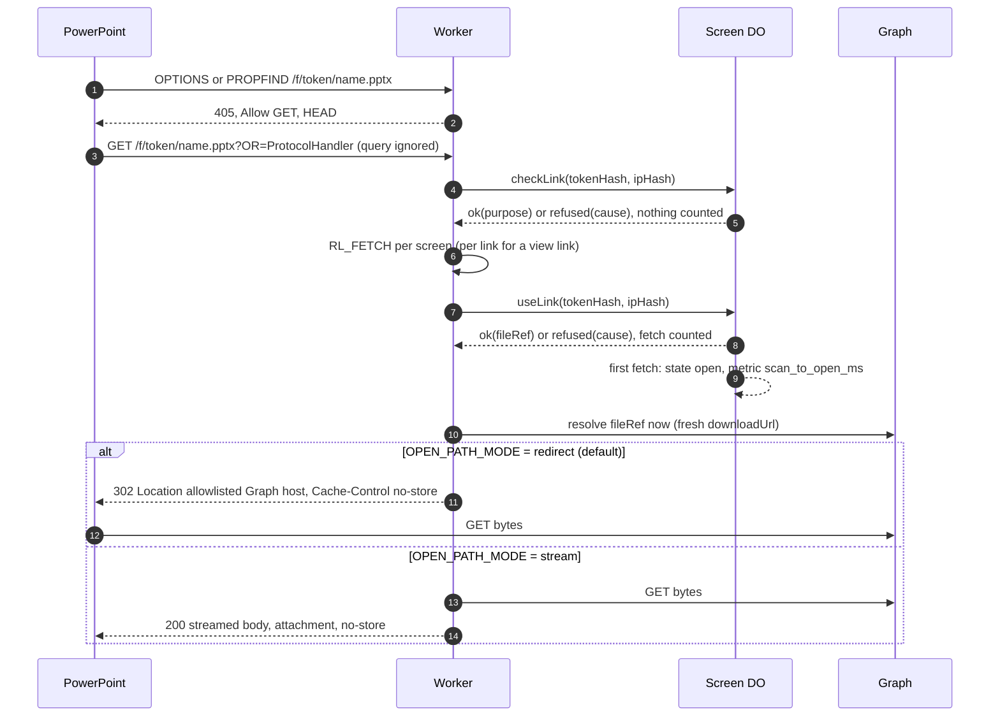
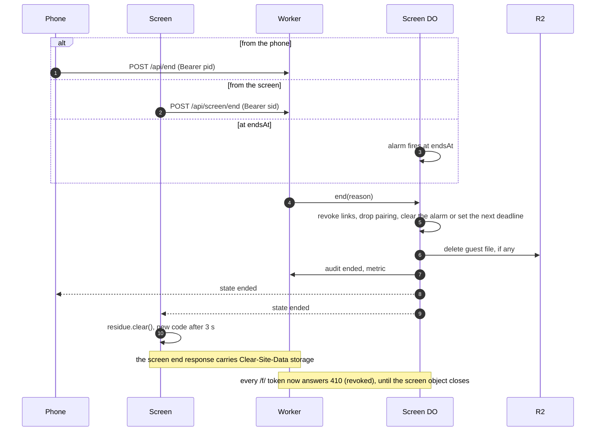

# bloop architecture

Status: draft for review. The stack is fixed by [ADR 0001](adr/0001-stack.md). The choices it leaves open are settled in ADRs 0002 to 0008. Contracts are in [interfaces.md](interfaces.md), and threats in [threat-model.md](threat-model.md). Section 1 and the flows are restated for IT teams and lecturers in `/articles/how-bloop-works`; this file stays the source.

## 1. What the system does

A room PC's browser shows `/s`, with a QR code and a typed code. A phone scans or types the code, which locks the pairing to that phone. The phone shows the room name and a 2-digit match code. The user picks one file, from OneDrive or as a guest upload, and taps Approve. The screen then gets one short-lived link, `https://<host>/f/<token>/<name>.pptx`, and opens it with `ms-powerpoint:ofv|u|<link>`. If that fails it falls back to a download, and after that to a labeled PDF view. The session ends from the phone, from the screen, or by itself after 1 hour, a length the phone can change up to 12 hours (2 in the Demo).

Invariants (each one is enforced in code and proven by a test in the threat model):

1. The screen holds a screen credential (`sid`) and the links of the current session, never an account, a cookie for an account, or a Microsoft token.
2. Each code works once and lasts 60 s, plus a 10 s grace after its successor appears.
3. One session gets one file. A link names that file only, and dies when the session ends.
4. Every secret that travels in a URL is short-lived, single-purpose, and stored only as a hash.
5. Demo sessions never touch the token vault or a real file source.

## 2. Context (C4 level 1)

```mermaid
flowchart LR
  user([Presenter or guest, with a phone])
  admin([IT or AV admin])
  pc[Room PC: a browser on /s, plus installed PowerPoint]
  bloop[bloop: pairs a phone with a screen and hands the screen one file link]
  entra[Microsoft Entra ID]
  graph[Microsoft Graph and OneDrive]
  user -- "scan, sign in once, choose, approve, end" --> bloop
  pc -- "shows codes, receives one link" --> bloop
  pc -- "PowerPoint fetches /f/ link" --> bloop
  bloop -- "OAuth code flow with PKCE" --> entra
  bloop -- "list recent decks, resolve download URL" --> graph
  pc -. "redirect mode: PowerPoint downloads from Graph" .-> graph
  admin -- "reads /security, exports audit" --> bloop
```

## 3. Containers (C4 level 2)

```mermaid
flowchart TB
  subgraph browser[Browsers]
    s["/s screen page"]
    a["/a, /code phone pages"]
    l["/ landing, /privacy, /terms, /security"]
  end
  subgraph cf[Cloudflare account, one Worker, one origin]
    assets[Static assets: dist/, public/ with its JS minified and CSS stripped, served directly, headers from _headers]
    w[Worker: fetch handler with URLPattern routes, plus scheduled handler]
    scr[(Screen Durable Object, one per screen, SQLite, hibernating WebSockets, one alarm)]
    dir[(Directory Durable Object, one instance: typed code to screen, guess counters)]
    d1[(D1, eu: users, grants, sessions, audit, metrics, rooms)]
    r2[(R2, eu: guest files, 1-day lifecycle rule)]
    rl[Rate-limit bindings]
    sec[Secrets: KEKs, Entra client secret, pepper, cookie key]
  end
  s & a & l -->|GET pages| assets
  s & a & l -->|"/api/*, /auth/*"| w
  ppt[PowerPoint on the PC] -->|"/f/*"| w
  w --> scr
  w --> dir
  w --> d1
  w --> r2
  w --> rl
  scr --> d1
  scr --> r2
  w -->|token endpoint| entra[Entra ID]
  w -->|Graph API| graph[Graph]
```

| container    | owns                                                                                                                     | does not own                                                        |
| ------------ | ------------------------------------------------------------------------------------------------------------------------ | ------------------------------------------------------------------- |
| Worker       | routing, header policy, Origin checks, validation (Zod), OAuth, token vault, Graph calls, `/f/` serving, retention cron  | session state (that lives in the Screen object)                     |
| Screen DO    | the state machine of one screen: codes, pairing, the approved file, links, timers, both sockets, exact per-screen limits | anything that outlives a session, except audit rows it writes to D1 |
| Directory DO | typed code to `screenRef` routing, global failed-lookup counters per hashed IP                                           | session state                                                       |
| D1           | long-lived records (section 8)                                                                                           | live pairing state                                                  |
| R2           | guest file bytes during one session                                                                                      | anything else                                                       |

Every Durable Object namespace is used through `namespace.jurisdiction("eu")`. Why there are two DO classes: ADR 0002.

## 4. Flows

### 4.1 Pairing, approve and open (OneDrive)

```mermaid
sequenceDiagram
  autonumber
  participant S as Screen /s
  participant W as Worker
  participant D as Directory DO
  participant R as Screen DO
  participant P as Phone /a
  participant G as Graph
  S->>W: POST /api/screens (mode live)
  W->>R: create(screenRef random, room or none)
  R-->>S: sid, room view
  S->>R: WebSocket /api/screen/ws, first message hello(sid)
  R->>D: put(code, screenRef, expiresAt)
  R-->>S: code K7MQ9X, expires in 60 s
  Note over S: QR encodes https://host/a?c=K7MQ9X
  P->>W: POST /api/claim {code}
  W->>D: lookup(code, ipHash)
  D-->>W: screenRef
  W->>R: claim(code, phone)
  R-->>P: pid, room, match 42, mode, needsAuth
  R-->>S: state claimed, match 42
  alt no phone session yet
    P->>W: GET /auth/start
    W-->>P: 302 to Entra authorize (state, PKCE S256, nonce in AEAD cookie)
    P->>W: GET /auth/callback?code&state
    W->>W: exchange code, check iss and tid, encrypt refresh token
    W-->>P: Set-Cookie session, 302 to /a (pairing resumes from sessionStorage)
  end
  P->>W: GET /api/files (Bearer pid, cookie)
  W->>G: list recent decks (access token from vault)
  W->>R: listed(ids)
  R-->>S: state choosing
  W-->>P: up to 5 files, then the account's links
  P->>W: POST /api/approve {ids} (Bearer pid, Origin checked)
  W->>R: approve(items resolved from the list)
  R->>R: mint link token, schedule auto-end at endsAt (+60 min; the phone may change it, SESS-01), audit approved
  R-->>S: open {item 0, links.protocol}
  R-->>P: state opening
  S->>S: location.assign(ms-powerpoint:ofv|u|https://host/f/token/Lecture-4.pptx)
```
Phone page loads strip the code from the address bar with `history.replaceState` before any other script runs.

### 4.2 Open path (`/f/`)


The Worker answers a `/f/` request in this order: the per-IP rate limit, the token's shape, the Screen object's link rules (`checkLink`, which counts nothing), the per-screen rate limit (per link for a view link, VID-02), the counted fetch (`useLink`), the source (`resolve`, or `resolvePdf` for a PDF link), then the OpenPath answer. A token that is malformed, unknown, or from a screen that no longer exists is the same 404. A source with no download URL (the mock, guest files) streams in either mode, with `Content-Length` when the size is known. HEAD answers from the metadata and counts as a fetch, as GET does. A video's single `Range` is answered 206 (VID-02); every other type is answered whole (T3 records whether Office sends Range).

The screen reports `launched` once. The screen shows Download It Instead at once, as the secondary action; Download mints a fresh link for the same approved file, or for the item the request names (`POST /api/screen/link`, the item's first link free, then at most 5 more), and the fetch of it moves the session to `open` with `openMode: download`, which both pages show as "PowerPoint didn't open.". There the screen also offers Show as PDF Instead, which mints the `pdf` link and opens it in a second window; it is hidden when no PDF can exist (a guest's deck, a photo or a video). A launch made without user activation also shows an Open button, whose click launches again: the browser may refuse an external-protocol launch that no gesture caused (field check T3). After a reload, an approved screen that gets no `open` frame asks for the protocol link itself. A fetch of any link, whatever its purpose, is the first accepted fetch. ADR 0003 covers the details.

### 4.3 End and auto-end


Backstops: an hourly cron ends any D1 `session` row still open past the longest a session can last after its approval or claim (`longestSessionMs`: two claim windows, an upload and the 12 h cap, plus 5 min; `closeStaleSessions`, `end_reason` `auto`), and lists `g/` in the bucket and deletes any guest object older than that (plus 10 min), closing the matching `guest_file` rows. Both follow the cap, not a fixed age, so a session the phone made longer keeps its row open and its file. The R2 lifecycle rule (`tools/r2-lifecycle.json`, applied once by the owner, `docs/setup.md`) deletes anything under `g/` older than 1 day.

### 4.4 Guest drop (host absent)

The default needs no host and no sign-in. The Open click on the screen is the proof that someone is at the lectern.

1. The guest scans the screen's code (or types it). `POST /api/claim {code}` locks the pairing to that phone, as for anyone. The scan does not say who is scanning, so the phone shows its usual choice, with "Send a File Instead" as a text action where there is nothing to choose from (and beside Approve). A claim made with `kind: "guest"` goes straight to the guest's landing (a list of one row, Add a File, which opens the native picker).
2. The phone shows the guest states (confirm, sending, refused: design.md section 7; a file it can refuse itself is a toast), checks the extension and size itself, prepares a photo (`core/photo.js`: a JPEG, PNG or HEIC decoded upright, scaled to at most 2560 px on the long side and re-encoded as JPEG at quality 0.82 (a PNG with transparency as PNG) through a canvas of that size at most, which drops every metadata field including the location; the re-encode is always what goes, even when the original is smaller, and a photo the browser cannot decode or re-encode (a HEIC outside Safari among them) is refused, so a photo's original bytes never leave the phone; a video has its location values blanked in place by `core/video.js` (a `udta` may end with QuickTime's 4-byte zero), and one whose structure it cannot walk is refused; a media module that fails to load is a refusal too; none of it is a server check), and sends the file with `PUT /api/drop` (Bearer pid, `Origin`, `Content-Length` required, `X-Bloop-Name`). The Worker checks the declared length and name, and asks the Screen DO to begin: the DO applies the room's policy, refuses a second file with `already_uploaded`, checks the cap (`too_large`) and moves the session to `uploading`; an owner claim becomes a guest here. The Worker then reserves budget in D1 (`storage_full`), streams the body to R2 through a fixed-length stream and a digest, and validates by range reads (head, zip central directory or PDF tail; a deck up to 16 MiB is read whole in one operation, a larger one in at most 72 coalesced ranges: `src/worker/seams/guest-drop/read-plan.ts`). The only inflates are the small `[Content_Types].xml` and relationships parts.
3. Valid: the Worker tells the Screen DO (`dropDone`), which moves to `offered`. Nothing opens yet. The screen shows the file name with an "Open" button (string `guest_open`: heading "{file name}", line "Sent by a guest. Open it here when you're ready.", control "Open"); the phone shows "Sent to {room}." Invalid or failed: the object is deleted, the DO returns to `claimed` (`dropFailed`), and the phone shows "This file can't be sent." (or the cause's state: `busy` for `storage_full`, an error for an aborted upload).
4. A click on the screen's Open button sends `open.click` on the screen socket. The Screen DO moves to `approved`, and the open path runs as in 4.2, served from R2. The file opens in PowerPoint (`.pptx`) or the browser PDF viewer (`.pdf`). The click also supplies the user gesture that launching `ms-powerpoint:` likely needs (T3). An offer nobody clicks expires after `CLAIM_TIMEOUT_SECONDS`, and the object is deleted.
5. At end, the object is deleted (4.3): by the Screen DO's `purge` seam, which deletes by the file's key when the session holds the file and by session id when an upload had no ref yet (a cancel, Start Over or timeout mid-upload), marks `guest_file.deleted_at`, and audits `guest.deleted`. A route that finds its session gone when the bytes land deletes the object itself.

Per-room policy (ADR 0005): `open` (default) is the flow above. `pass` is optional and IT turns it on per room: the host signs in on their phone and creates a guest link (`POST /api/guest-passes`, `https://<host>/g#p=<pass>`, 24 h, one session; the pass sits in the fragment, so it never reaches a server log). The guest opens `/g`, which keeps the pass in `localStorage`, and sends it with the claim (`POST /api/claim {code, pass}`). The screen-side Open click still applies. `off` refuses drops.

### 4.5 Demo

`/s?mode=demo`, entered from the landing, opens a demo screen (`POST /api/screens {mode: "demo"}`). Differences from the live flow:

- the file source is always `MockFileSource`, fixed at screen creation on the server. A client cannot switch it. The demo account lists Sample deck.pptx, Sample deck.pdf (the deck's export, and its rendition), Dog.jpg and one link, Vevox (interfaces.md section 3); the phone approves any of them as one list;
- the screen launches nothing: no `ms-powerpoint:` and no `window.open`. On the launch link it fetches the link itself (a HEAD, as PowerPoint would; an image's view link it shows as the image instead), which moves the session to `open`, and from `approved` to `open` it shows every approved item in a viewer in the page (`public/js/viewer.js`), built from the screen's state (`demo_open`), so a reload or a dropped socket shows it again: a sidebar of the items, and the chosen one on the stage. The sample deck and its PDF show as pre-rendered slide images (`public/img/demo-slide-*`, `tools/render-slides.py`; prev and next, arrow keys, Present), an image as itself (another item's view link is minted with `protocol` and that item), a link as a card that opens it in a new tab, a guest's photo as an image and a guest's video in a `<video>` (`public/js/viewer-video.js`, lazy), and a guest's deck or PDF as a card. A live screen shows a guest's photo or video in the same viewer (design.md section 7, The viewer). Download mints a fresh download link for the shown item on the click;
- one device can play both parts: in the waiting state the demo screen offers "Approve on This Device", a same-tab link to `/a?c=<code>`; `/a` then offers "See It on the Screen" back to `/s?mode=demo`, which resumes the screen from the sid in that tab's `sessionStorage`. Only the tab that created a screen holds its sid, and a stored sid resumes only a screen of the page's mode. A demo screen runs at phone width; a live one asks for the room's screen;
- the phone gets no OAuth step, and demo routes never read the phone session cookie;
- the session starts at 1 hour as a live one does, and the phone can set it up to 2 hours from approval (`DEMO_MAX_MINUTES`, the live cap is 12), and guest drops are capped at 25 MB (`DEMO_GUEST_MAX_BYTES`), and the Open click applies as in 4.4;
- the demo has its own rate limits (section 6): stricter per-IP bindings for creating and claiming, and a global cap on concurrent demo screens held in the Directory (`DEMO_MAX_CONCURRENT`) and a per-IP-hash cap (`DEMO_MAX_PER_IP`) so one address cannot fill it. A demo screen takes a slot at creation, for one claim window plus the longest demo session, and gives it back when its session ends or the screen closes; a screen that outlives its hold stops counting. `DEMO_ENABLED=false` makes `POST /api/screens {mode: "demo"}` and any claim of a demo code answer `not_found`;
- its session and audit rows are `mode = demo` with no user, and are kept 7 days;
- the landing embeds no demo: its Try the demo button opens `/s?mode=demo`, and the landing's hero stage is a static panel, with no connection.

ADR 0007 covers this.

## 5. Repo layout

One npm package. Runtime dependencies: the list in ADR 0001.

```
package.json  package-lock.json  wrangler.jsonc  biome.json
tsconfig.json              Worker + shared, strict, workers-types
tsconfig.node.json         tests and tools, node types (the two type sets clash if mixed)
tsconfig.public.json       checkJs over public/ (JSDoc), DOM lib, imports types from src/shared via @import
vitest.config.ts  vitest.int.config.ts  playwright.config.ts  lighthouserc.json  .htmlvalidate.json
.dev.vars.example
migrations/                0001_init.sql, numbered, raw SQL (wrangler d1 migrations)
src/shared/
  protocol.ts              contracts: messages, views, error codes, and OPEN_MODES, the one runtime list (never served; browser JS imports the types through JSDoc @import)
src/worker/
  index.ts                 fetch + scheduled entry, route table
  http.ts                  json(), problem(), origin and fetch-metadata checks, body limits
  rate-limit.ts            the platform rate limit's one call and the pseudonymous IP key, for the routes and the page gate
  headers.ts               the header policy; applied to every Worker response
  origin.ts                the 301 from a workers.dev host or plain http to PUBLIC_ORIGIN (or the 403 for a write)
  config.ts                Zod schema for env, fails closed at startup
  do/demo-slots.ts         the global cap on concurrent demo screens (SQL in the Directory object)
  machine.ts machine/      pure session state machine: types and dispatcher, one reducer file per event group (interfaces.md 2.3)
  items.ts                 the session's items: types, MAX_ITEMS, order, the link allowlist (ADR 0009)
  do/schema.ts             the Screen object's numbered storage steps (schemaVersion) and `applySteps`, which every object's steps use
  do/directory-schema.ts   the Directory object's tables and numbered steps (the `code` expiry index)
  do/screen.ts  do/directory.ts
  seams/file-source/{index,mock,demo,graph}.ts   interface; MockFileSource; the bundled demo account; GraphFileSource
  source-access.ts         which source serves a screen (mode and FILE_SOURCE), and the server-side resolve of an approved id
  seams/open-path/{index,redirect,stream,select,links}.ts   OpenPath interface; the 302 and the streaming answer; the mode switch; link minting, life rules, client class
  do/ledger.ts             the per-screen link record (hashes and counters, revoked tombstones)
  seams/guest-drop/{index,select,r2,purge,validate,zip}.ts   GuestDrop interface and limits; the one place that picks R2; the R2 and D1 ledger adapter; deletion at session end; type and structure checks; zip directory reader
  audit.ts audit-d1.ts   AuditLog interface and the D1 store (one row per event, session row mirror, export stream, purge, erasure)
  metrics.ts metrics-d1.ts   Metrics interface, percentile and ISO-week math, and the D1 store (events, rollup, summary)
  export-format.ts         CSV with formula-injection protection, export columns, date range parsing
  stores.ts                the one place that picks the AuditLog and Metrics implementations
  auth/{oauth,vault,sessions,cookies,services,db}.ts   oauth4webapi flow; token vault; phone sessions; cookie format and AEAD seal; per-request objects and the daily job; the D1 slice
  auth/{codes,templates,email,turnstile}.ts   email codes and the known-device value; every email's text; the one mail sender (ADR 0021); siteverify (ADR 0022)
  routes/{pairing,files,open,drop,control,auth,export,common}.ts
  cron.ts                  the cron dispatcher; cron-jobs.ts lists each trigger's jobs
  retention.ts             closeStaleSessions (hourly), runRetention (daily)
public/                    the assets' source, built into dist/ (each JS module minified, each stylesheet stripped of comments and whitespace, everything else as it is), which wrangler serves. Everything here is public: no secrets, no server-only logic
  index.html security.html privacy.html s.html a.html code.html 404.html
  _headers                 static security headers (section 10)
  _redirects               /it answers 301 to /security; /demo 302 to /s?mode=demo
  css/base.css             what every page uses: tokens, reset, buttons, glass, the reduced-motion net; linked first
  css/site.css css/app.css   the site pages' rules (and the Worker's auth error page); the task pages' rules
  js/{screen,phone,code,launcher,residue}.js   task pages; js/vendor/uqr-1289037a/uqr.js (+ LICENSE)
  js/viewer.js js/core/demo.js   the screen's viewer, the demo's and a guest's photo or video (sidebar, stage, pager, link card, its own link fetch); its pure parts
  js/viewer-video.js   a guest's video on the stage, loaded by import() with the first video link
  js/core/length.js js/core/length-extra.js js/shared/length.js css/length.css   the phone's Session Expiry sheet, loaded on its first tap, with its time rules and words (Set stays off until they are in); the length floor the route shares
  js/core/poll.js js/core/health.js   the channel's polling loop and ping rule, loaded on first need
  js/core/clicker.js   a presenter's clicker keys (F5, Home, End), loaded when the viewer first shows an item
  js/core/net-states.js   the room screen's words for a blocked network and a service that is down, loaded by the first of them
  js/core/drag.js   the phone's drop hint, loaded at its first file drag
  js/core/remote-ui.js js/core/remote.js css/remote.css   the phone's remote, fetched once its claim is a demo's; its state (seq, the tap shown before the answer)
  js/core/lazy.js   what the length sheet and the remote share: their stylesheet's load, a refusal as a toast
  js/core/upload.js js/core/pill.js js/core/upload-pill.js css/upload.css   the upload engine (no DOM), the pill's face, their binding with the batch sheet, and the stylesheet; loaded on the first intent to add (docs/ux/upload.md)
  img/demo-slide-{n}.{avif,webp}   the sample deck's pages, shown for the deck and its PDF (tools/render-slides.py)
  img/hero-viewer-{750,1100,1600,2200}.avif, {750,1100,1600}.webp   the landing stage's screenshot of the Demo Room, 640 up
  js/site.js               the landing: the nav's scrolled look, closing the menu on a link click, the stage tilt's spring, the FAQ's height tween where CSS cannot (no other site page runs a script)
  og.png apple-touch-icon.png (tools/render-og.py); favicon.svg, the logo, drawn as paths
  fonts/inter-latin-cc089b5d.woff2  the one font file (tools/subset-font.py) + inter-90ef5e81.LICENSE.txt
  js/shared/               runtime code shared by browser and Worker: plain JSDoc-typed ES modules
    codes.js               code alphabet, normalize, format "K7M Q9X" (pure)
    names.js               the /f/ link's name segment: an ASCII slug (pure)
    errors.js              error code to HTTP status and user-facing state (pure)
  .well-known/security.txt
src/fonts/InterVariable.woff2   the source of the font subset, never served
tools/
  staging.mjs              the staging deploy's resource check, D1 id and secret steps (.github/workflows/staging.yml)
  build-assets.mjs build-assets-cli.mjs   public/ to dist/, each JS module minified on its own, CSS stripped of comments and whitespace (ADR 0011); wrangler runs the CLI before dev and deploy
  make-fixtures.mjs        writes the synthetic sample decks the tests use
  render-slides.py         the demo deck's PDF export to the demo screen's slide images
  change-tier.mjs          classifies the staged diff (T0 to T2) and enforces the commit-msg blocks
  render-og.py og.svg      the social image and the touch icon, from the logo; og.svg is the image's SVG source
  subset-font.py           Inter to the Latin subset, wght 400 to 600, opsz kept
test/
  unit/                    vitest + fast-check: machine, codes, names, zip, vault, csv, headers
  integration/             against a real wrangler dev (wrangler.ts starts one on a free port): every route, sockets, timers, threat tests
  e2e/                     Playwright, two contexts (screen, phone), axe, CI only
  fixtures/decks/          synthetic sample decks (written by tools/make-fixtures.mjs), later polyglots, zip bombs, macro decks
  fixtures/graph/          synthetic Graph JSON for the contract tests (README says so)
  fixtures/jsdoc/          a good and a bad browser module, proving JSDoc @import of protocol.ts is type-checked
```
`.wrangler/` and `dist/` are gitignored. `wrangler.jsonc` sets `assets.directory` to `./dist` and `build.command` to `tools/build-assets-cli.mjs`, so a local `wrangler dev` and `wrangler deploy` rebuild `dist/` from `public/` first (ADR 0011); the CI deploy jobs do not build, they check the check job's artifact (section 12). The Worker imports `public/js/shared/*.js` by relative path, and wrangler's own esbuild bundles it. Type-only contracts stay in `src/shared/*.ts` so they are never served.

## 6. Routes

`run_worker_first` lists every path but the static trees (`/js`, `/css`, `/img`, `/fonts` and the two icons, which the asset layer answers itself): every other request reaches the Worker, which first redirects a GET or HEAD for a `*.workers.dev` host (except `/fo/ping`, which that host answers itself: section 13), or for the origin's own hostname over plain http, with a 301 (cacheable for an hour; `no-store` for `/f`, `/b`, `/p` and `/fo`, whose paths are secrets) to the same path and query on `PUBLIC_ORIGIN` (`origin.ts`); a write or WebSocket upgrade on those hosts is refused with 403 `forbidden_origin`, not redirected, and any other host is left to the Origin and config checks. Then `/api/*`, `/f/*` and `/auth/*` go to the routes, and everything else is served from the asset binding (`html_handling: "drop-trailing-slash"`, so `/s` serves `s.html`; `_headers` and `_redirects` still apply). `wrangler dev` needs `--infer-origin-from-routes=false`, or the Worker sees `bloop.here` as its host.

| method                   | path                                         | auth                                  | purpose                                                        |
| ------------------------ | -------------------------------------------- | ------------------------------------- | -------------------------------------------------------------- |
| GET                      | `/`, `/privacy`, `/terms`, `/security`, `/s`, `/a`, `/code`, `/.well-known/security.txt` | none (static) | pages; `/it` answers 301 to `/security`; any other path is `404.html` with status 404 |
| POST                     | `/api/screens`                               | none                                  | create a screen: `{mode}` to `{sid, room}`                     |
| GET                      | `/api/screen/ws?ref=<screenRef>`             | `hello{sid}` as first message, Origin | screen socket (the ref only routes to the object; it is no secret) |
| GET                      | `/api/screen/state`                          | Bearer sid                            | polling fallback; also the rotation clock when there is no socket. A poll writes nothing unless a code is due or the close deadline is a tenth of its window stale |
| POST                     | `/api/screen/restart`                        | Bearer sid                            | "Start Over" on the screen: drop an unapproved claim, new code |
| POST                     | `/api/screen/link`                           | Bearer sid                            | one more link for an approved file `{purpose: protocol, download, pdf or view, item?}` to `{item, links}` (`item` defaults to the first file; a link item is `file_not_found`); an item's first link is free, then each counts against that item's `LINK_MINTS_PER_ITEM`; `protocol` only from `approved` (the screen lost its link) |
| POST                     | `/api/screen/shown`                          | Bearer sid, Origin; `RL_CONTROL`      | the screen reports its own tap, `{item, page, present, seq}` (an item id, a 1-based page, the screen's own seq), so the phone's highlight stays true; the same rules as `/api/control`; demo sessions only |
| POST                     | `/api/screen/end`                            | Bearer sid                            | end; from `waiting` it closes the screen at once (a demo slot is freed); response carries `Clear-Site-Data: "storage"` |
| POST                     | `/api/claim`                                 | none; rate-limited                    | `{code, kind?}` to `{pid, room, match, mode, kind, needsAuth, dropMaxBytes}` |
| GET                      | `/api/pair/ws?ref=<screenRef>`               | `hello{pid}`, Origin                  | phone socket                                                   |
| GET                      | `/api/pair/state`                            | Bearer pid                            | polling fallback                                               |
| GET                      | `/api/files`                                 | Bearer pid, plus session cookie when `FILE_SOURCE=graph` and the screen is live | up to 5 recent files, then the account's links, as `{items: Entry[]}`; tells the Screen object the ids shown |
| POST                     | `/api/approve`                               | Bearer pid, plus cookie as above, Origin | `{ids}`, 1 to 12 distinct entry ids; the Worker resolves each item from the source's list, so an id not in it is `file_not_found` |
| PUT                      | `/api/drop`                                  | Bearer pid, Origin                    | guest upload, raw body, `X-Bloop-Name` (percent-encoded), `Content-Length` required, octet-stream, PDF, PPTX, JPEG, PNG, MP4 or MOV content type; answers the phone's view (`offered`) |
| POST                     | `/api/control`                               | Bearer pid, Origin; `RL_CONTROL`      | the phone's remote, `{item, page, present, seq}`: an approved FILE item's id, a 1-based page within its pages, whether to present, and a seq that grows per sender (`ShownCommand`). Absolute, so a replay is a no-op, and a seq not above the phone's last applied one changes nothing. Demo sessions only (live is `wrong_state`); a link or unknown id is `file_not_found`, a page out of range `bad_request`; answers the phone's view |
| POST                     | `/api/session/length`                       | Bearer pid, Origin; `RL_CONTROL`      | the phone sets when the session ends, `{seconds}` (interfaces.md `LengthRequest`): `endsAt` becomes now plus seconds, never past approval plus the mode's cap (12 h live, 2 h demo); both modes; before approval or after the end `wrong_state`; answers the phone's view, and both sockets get the new `endsAt` (SESS-01) |
| POST                     | `/api/cancel`                                | Bearer pid, Origin                    | cancel before approve                                          |
| POST                     | `/api/end`                                   | Bearer pid, Origin                    | end from the phone                                             |
| GET                      | `/api/me`                                    | session cookie, or none               | a member (a deleting one too): `{source, signedIn: true, email, admin, launchMode, status, deleteAfter, passkeys, quota: {used, total}, userHandle}`; an Entra user under `graph`: `{source: "graph", signedIn: true, email}`; anyone else `{source, signedIn: false, launchMode}`; with `FILE_SOURCE=mock`, no cookie and a local origin and request only, the demo account `{source: "mock", signedIn: true, email: null, launchMode}`; it never sets or clears a cookie |
| POST                     | `/api/me/signout`, `/api/me/signout-all`     | any live session, Origin              | end this session and its screens, or every session and screen of the user (AUTH-13); clear the session and hint cookies, and for signout-all the device cookie too, even when the session is already dead (`auth_required`); an Entra grant stays |
| GET, DELETE              | `/api/me/sessions`, `/api/me/sessions/:id`   | member session; DELETE: Origin        | the user's live sessions `[{id, label, method, createdAt, lastSeenAt, current}]` (`id` is the public id); DELETE ends another one and its screens (204); the current one is `bad_request` |
| GET, PATCH, DELETE       | `/api/me/passkeys`, `/api/me/passkeys/:id`   | member session; writes: Origin; DELETE: fresh proof | `[{id, name, createdAt, lastUsedAt, backedUp}]`; PATCH `{name}` (1 to 40 letters, digits, emoji, spaces, hyphens and apostrophes: `auth/names.ts`); DELETE 204, `reauth_required` without a proof within `REAUTH_SECONDS` |
| POST                     | `/api/me/restore`                            | member session (deleting too), Origin | cancel a requested deletion inside its grace (ADR 0013); `restore_too_late` after it or for a blocked address |
| GET                      | `/api/me/audit`                              | member session, or an Entra session under `graph` | `{rows, nextId}`: the user's own audit rows, most recently recorded first, `limit` (1 to 200, default 50) and `beforeId` (the `id` of the last row) for the next page; `nextId` is null on the last page. A paged query cursors on a unique column, never a timestamp (`cursor-rule.test.ts`). Grant rows are about the account, so their `sessionId` is `user:<id>` |
| POST                     | `/api/me/disconnect`                         | session cookie, Origin; `graph` only  | delete the grant and every session of the user, and end their screens as sign out everywhere does |
| DELETE                   | `/api/me`                                    | session cookie, Origin                | an Entra user under `graph` is erased (DATA-05): `user.erased` is recorded first (a failed record means nothing is erased), then audit rows are anonymized (user id and file name dropped, grant rows re-scoped to `erased`), then the user row goes and cascades the grant and every session. A member with a fresh proof starts the deletion grace instead: status `deleting`, every other session and every screen end, this session stays for restore |
| POST                     | `/api/admin/view`                            | admin session, Origin                 | `{open, reason}` sets (8 hours) or clears `__Host-bloop_view` and logs an `admin_action` row (ADR 0026); anyone else gets `not_found`, whatever the Origin, body or method |
| GET                      | `/api/it/export`                             | Bearer IT export token; 401 while unset | `?format=json` (default) or `csv`, `&data=audit` (default) or `metrics`, `&from&to` as UTC days (default last 30, at most 366); 400 otherwise; `attachment`, `no-store` |
| GET                      | `/api/health`                                | none                                  | status line probe, no state                                    |
| GET                      | `/auth/start`                                | none; `RL_AUTH` (rate limits below)   | 302 to Entra; no return parameter exists                       |
| GET                      | `/auth/callback`                             | AEAD state cookie                     | code exchange, then 302 to `/a` (fixed). 400 `bad_request` for a state, cookie or expiry failure (no cookie set), 403 `consent_declined` or `admin_consent_required` for an Entra refusal, 401 `unauthorized` when the ID token fails validation, 502 `source_unavailable` for a failed exchange. Every failure is a small HTML page in the design voice (`auth/error-page.ts`, app policy), never raw problem+json, because the callback is a top-level navigation |
| GET, HEAD                | `/f/:token/:name`                            | the token                             | open path; query string and name ignored; 404 for any unknown or malformed token, 410 for a dead one |
| OPTIONS, PROPFIND, other | `/f/*`                                       | none                                  | 405 `Allow: GET, HEAD`                                         |
| GET | `/fo/ping` | none; file-origin host only | live now: 204 for the file-origin probe (section 13) |
| GET | `/signin`, `/invite`, `/library`, `/account`, `/admin`, `/report` | pages | gated by launch mode (section 13); the forms and APIs behind them are planned |
| POST, GET, PATCH, DELETE | `/api/invite/*`, `/api/auth/*`, `/api/me/*` additions | none, or session | planned (A): invites, email code, passkey sign-in and registration, reauth, email change and revert |
| GET, POST | `/api/admin/*` other than `/api/admin/view` | admin session | planned (A): invites, waitlist, reports, users, files, launch mode and gate |
| POST | `/api/hooks/tally` | signature, no Origin check | planned (A): the waitlist webhook |
| POST | `/api/reports` | Turnstile | planned (A): a public report |
| GET, DELETE | `/api/dev/mailbox` | none (DELETE: Origin); `not_found` unless `DEV_MAILBOX` is set | local and test harness only: `?to=` lists the kept mail, newest last; DELETE clears it |
| GET, POST | `/api/uploads`, `/api/uploads/:id/urls`, `/api/uploads/:id/parts/:n/done`, `/api/uploads/:id/complete` | member session; Origin on writes | live (U): list, create or resume, part URLs, part confirmation, complete ([uploads.md](uploads.md)) |
| PUT | `/api/uploads/:id/parts/:n` | member session; Origin | live (U): one part through the Worker (proxy mode); `Content-Length` must equal the part's size |
| GET, DELETE | `/api/uploads/:id` | member session; Origin on DELETE | live (U): the upload's state (a pure read), and cancel; another member's id is `not_found`. Every JSON write needs a numeric `Content-Length` of at most 4096 |
| any | `/api/uploads/*` for a guest | Bearer pid | planned (U): the guest drop moves onto this pipeline; `PUT /api/drop` is removed when it lands |
| any | `/api/dev/r2/*` | none; local only | planned (U): the proxy-mode bucket stand-in |
| GET, PUT, PATCH, POST | `/api/library*` | member session (C), `RL_LIBRARY` per user | list, rename, tick, Up Next order, trash, restore, Delete Now, preview link, socket: [library.md](library.md) section 5 |
| GET | `/api/me/export.zip` | member session, same-origin, C+R for a new export | `?k=<idempotency key>`; the account export as a zip with exact `Content-Length`, `ETag` and `Range` resume (docs/library.md section 8); 409 `export_busy`, 429 `export_limit`, 503 `export_paused` |
| GET, DELETE | `/api/me/screens`, `/api/me/screens/:sessionId` | member session | the user's live screens, and ending one; `{ended}` is 0 for a screen already gone |
| POST | `/api/library/sample` | session | planned (L): the sample deck |
| GET, POST | `/api/match`, `/api/notes`; `/api/claim`, `/api/files`, `/api/approve` extended | Bearer pid, session | planned (P1): the match pick, speaker notes, the library source |
| GET | `/f/`, `/b/`, `/p/` on the file origin | the token | planned (P1): session links, bundles, owner previews |

Every ok JSON answer carries `X-Bloop: 1` (`json()` in `http.ts`), so `api.js` reads a 200 without it, or one that is not JSON, as the client-only `network_blocked` (a filter's block page), never `service_down`.

Every state-changing route checks four things: `Origin` equals `PUBLIC_ORIGIN`; `Sec-Fetch-Site` is `same-origin` when present; `Content-Type: application/json` (or the declared upload type); and a Zod-parsed body. Bearer credentials come from `sessionStorage` and travel in `Authorization`, never in a URL. Errors are `application/problem+json` with an `ErrorCode` (interfaces.md). A POST with no fields still sends `Content-Type: application/json` and a body of `{}` (or no body): that header is what turns a cross-site form post into a 415. Bodies are at most 4 KB, and Zod schemas refuse unknown keys. `POST /api/claim` takes `{code, kind?}`: `kind` defaults to `owner`, and a phone that wants the guest drop path sends `guest`. Any other field, a `pass` included, is `bad_request`.

A regex that takes user text must not split any string into its top-level alternatives two ways, or a refused input backtracks exponentially: no code point may start two alternatives unless the shorter one dead-ends on the next character. `names.ts` proves it with a first-character scan of every code point and a worst-case timing per piece.

### Rate limits

| where                   | limit                                                                                | kind                |
| ----------------------- | ------------------------------------------------------------------------------------ | ------------------- |
| `POST /api/screens`     | 10 per 60 s per IP (`RL_CREATE`) | binding |
| `POST /api/claim`       | 20 per 60 s per IP (`RL_CLAIM`) | binding |
| failed code lookups     | 10 per 10 min per hashed IP, then 429 until the window (10 min from the first miss) ends; a global alarm at 1,000 per 10 min across all hashes (one `pair.miss_alarm` log line; it blocks nobody) | exact, Directory DO |
| next code on one screen | 6 per min                                                                            | exact, Screen DO    |
| `/f/`                   | 60 per 60 s per IP (`RL_FETCH`); then 60 per 60 s per screen (`RL_FETCH` keyed by the screen ref), or per view link (keyed by its hash), between the Screen object's check and the counted fetch; per link: 10 fetches, none for a view link (VID-02) | binding; exact      |
| `PUT /api/drop`         | 5 per 60 s per IP (`RL_UPLOAD`; every attempt past the Origin and credential checks counts); one accepted file per session; live bytes under `GUEST_STORAGE_BUDGET_BYTES` | binding; exact; D1  |
| `/auth/start`, `/auth/callback`, `POST /api/me/disconnect` | 10 per 60 s per IP (`RL_AUTH`); the disconnect then spends the member routes row's IP meter too | binding |
| member routes (`/api/me/*`) | every route: 300 per 60 s per IP (`RL_MEMBER_IP`) before any D1 read, a flood guard sized for a shared campus NAT; then, on every route but `DELETE /api/me` (a fresh proof bounds it) and the disconnect (`RL_AUTH`), 120 per 60 s per member (`RL_MEMBER`), the real limiter, after the session read (ADR 0014) | binding |
| `GET /api/me`           | `RL_MEMBER_IP` before any read, then `RL_MEMBER` once a live session is read (limits: the member routes row) | binding |
| `/api/admin/*`          | `RL_MEMBER_IP` (the member routes row) before the session read, a refusal answering the unknown path's 404 like everything else before the admin check; then 60 per 60 s per admin (`RL_ADMIN`) | binding |
| `GET /api/screen/ws`, `GET /api/pair/ws` | 30 per 60 s per screen ref and network (IPv4 address or IPv6 /64) (`RL_UPGRADE`, its own binding so reconnect storms never refuse a tap), before the Screen object; then at most 4 sockets waiting for their `hello` per role and 2 per network, the network's own oldest evicted at its 2 and the oldest overall when a role is full, never a refusal (PAIR-10) | binding; exact |
| `POST /api/control`, `POST /api/screen/shown`, `POST /api/session/length` | 120 per 60 s per IP (`RL_CONTROL`, its own binding so `/f/` range reads never refuse a tap), then 120 per 60 s per credential (keyed by the pid's or sid's hash, never the screen ref: every `/f/` token carries it) (PAIR-13) | binding |
| `GET /api/files`        | 20 per 60 s per session (`RL_FILES`, keyed by the screen ref), after the credential check: each call is a Graph call | binding |
| `/api/it/export`        | 10 per 60 s per IP (`RL_EXPORT`), checked before the token (a per-token key would not slow guessing) | binding             |
| demo screen creation    | 12 per 60 s per IP (`RL_DEMO_CREATE`), instead of the live limit | binding |
| demo claims             | 20 per 60 s per IP (`RL_DEMO_CLAIM`), after the lookup says the code is a demo one; the live claim limit applies first, so the lower of the two binds | binding |
| concurrent demo screens | `DEMO_MAX_CONCURRENT` across all visitors, and `DEMO_MAX_PER_IP` per IP hash (values in `wrangler.jsonc`); the next create answers 429 `rate_limited` | exact, Directory DO |
| demo screens            | plus a 60-min session and a 25 MB drop cap                                           | config              |
| `POST /api/auth/code/request`, `POST /api/me/reauth/code`, `POST /api/me/email` | 5 per 60 s per IP (`RL_CODE`), before Turnstile and any D1 code bucket; planned (A) | binding |
| `POST /api/invite/peek`, `POST /api/invite/accept`, `POST /api/email/revert` | 10 per 60 s per IP (`RL_INVITE`); planned (A) | binding |
| `POST /api/auth/passkey/options`, `POST /api/auth/passkey/verify` | 20 per 60 s per IP (`RL_PASSKEY`); planned (A) | binding |
| `POST /api/reports`, `POST /api/reports/context` | 5 per 60 s per IP (`RL_REPORT`), plus Turnstile on the report; planned (A) | binding |
| `/api/library*`, `/api/uploads` | 120 per 60 s per member (`RL_LIBRARY`); planned (L, U) | binding |
| `POST /api/uploads/:id/urls` | 240 per 60 s (`RL_UPLOAD_PART`); planned (U) | binding |
| every `/api/` path      | edge rule: 300 per 10 s per IP, block for 10 s; `/f/` excluded (SITE-09, setup.md step 9) | Cloudflare dashboard |

IPs are never stored. Limits use `HMAC(HASH_PEPPER, ip)` of `CF-Connecting-IP` (Cloudflare sets it; a local run has none and shares one key), kept only in DO storage until the window ends. The rate-limit bindings run in `wrangler dev` too. `TEST_TIMING=1` skips them so one integration run can create more screens than the per-IP limit allows; the exact limits in the objects stay on. Any other config answers the config-invalid 500 on a route whose binding is missing (`limited` in `routes/common.ts`; `RATE_LIMIT_BINDINGS` in `env.ts` is checked against `wrangler.jsonc` and `Env` by a test and the compiler), so a missing binding is never an open limit; the cron sweeps and the Screen alarms do not use the bindings and keep running.

## 7. WebSocket protocol

Both sockets are JSON text frames of at most 4 KB, `{"v":1,"t":<type>,...}`. A socket that fails to send a valid `hello` within 5 s (the object's alarm closes it, after an `error` frame), sends an unknown type, or sends an oversized frame is closed with 1008. A phone socket is closed with 1000 when its pairing is dropped (after `error pairing_invalid` for a cancel, Start Over or timeout), at that event only: a socket opened later (a reconnect) waits for its `hello`, which earns `error pairing_invalid` and 1008; closed on accept, before its 101, it would hear nothing until the client's missed-ping check. The upgrade is refused (403) unless `Origin` equals `PUBLIC_ORIGIN`, and (400) unless it carries a well-formed `?ref=`. The deadline is stored in the socket attachment and the object keeps one alarm at the earliest of it and the machine's next deadline, so it survives hibernation. `wrangler dev` writes the close frame on time but never closes the TCP connection after the handshake, so Node's `WebSocket` never fires `close` for it; the integration test reads the frames off a raw socket instead. Heartbeats use the DO auto-response (`ping` to `pong`), so they never wake the object. The client's reconnect, poll and failure rules are the table below. Every server message carries `now` (server epoch ms), so countdowns survive clock skew. Exact types are in interfaces.md (`ScreenMsgIn`, `ScreenMsgOut`, `PhoneMsgIn`, `PhoneMsgOut`).

| direction        | type        | body                                                                                |
| ---------------- | ----------- | ----------------------------------------------------------------------------------- |
| screen to server | `hello`     | `sid`                                                                               |
|                  | `code.next` | none (also sent when the tab becomes visible)                                       |
|                  | `launched`  | `mode: protocol or pdf`, sent once, at the first launch (any other state ignores it) |
|                  | `ping`      | none                                                                                |
| server to screen | `state`     | `ScreenView` (state, room, code, match, items, endsAt)                              |
|                  | `open`      | `item` and `links: {protocol, download, pdf, view}`, one field set per mint (sent once per mint; never repeated in `state`) |
|                  | `error`     | `code: ErrorCode`                                                                   |
| phone to server  | `hello`     | `pid`                                                                               |
| server to phone  | `state`     | `PhoneView` (state, room, match, items, endsAt for the countdown, maxMinutes, mode, kind) |
|                  | `error`     | `code`                                                                              |

**Channel state rules** (`core/channel.js`, its constants are in it; the polling loop is `core/poll.js` and the ping rule `core/health.js`, each loaded by `import()` on first need so a healthy page carries neither; the one owner, so a page restates none of it):

| Rule | Behavior |
|---|---|
| Reconnect | After 1, 2, 5, 10, then 30 s, each drawn from half to all of the step (REL-01), so screens dropped together do not return together. |
| Upgrade | A socket with no first frame in 4 s is given up and polling starts at once (REL-04). Two such timeouts in a row, with no socket ever opening, set `ws=blocked` in the tab's `sessionStorage` (not a `bloop.` key, so an end keeps it): the tab's next screen polls from its first second and tries the socket once a minute (same jitter); a socket that works clears it. A socket that opened but said nothing, or a plain outage, never sets it. |
| One socket, one drop | Every way a socket is given up (close, error, missed pings, the probe, the upgrade timeout) is one `drop`: its handlers go, it closes, the channel retries or polls. |
| One poll loop | Polling is one loop at a time, whoever asks (3 failed reconnects, an upgrade timeout, a blocked tab). A poll answered after the loop stopped or restarted ends there. |
| Poll cadence | 3 s while the room is set up, 15 s in `open`, 30 s in a hidden tab; a failed poll backs off 5, 10, then 30 s; a 429's `Retry-After` (whole seconds, at most 2 minutes) is a floor. |
| Silence | A visible tab's socket closes after two pings in a row with no frame back (REL-15); a hidden tab's, whose timers are throttled, after 70 s of silence. |
| Resume | A socket heard from within 25 s is left alone; a quieter one is pinged and replaced if nothing answers in 3 s (REL-02); one that is down reconnects, and its `hello` brings the state, so no read is made; a polling tab polls at once. |
| Failed poll or boot | `offline` and `network_blocked` (a 200 without the `X-Bloop` marker) are their own link states. `service_down` and `internal` say "bloop Isn't Responding" only on the second in a row; any other answer resets the count (R11). Poll and boot share the rule, except that a boot with no view yet has nothing to flap and says it on the first. |


Phone actions (approve, cancel, end, upload, control) and screen actions that change a session (end, link, restart, shown) use HTTP, so they get the Origin check, idempotency and a clear status. The sockets only push state: a remote command arrives as `shown` inside the ordinary `state` frame, so a reloaded or polling screen catches up with no frame of its own.

## 8. Data model

### 8.1 D1 (`eu` jurisdiction), `migrations/0001_init.sql`

```sql
-- ids are 128-bit random, base64url; *_hash columns are SHA-256 of a secret, never the secret
CREATE TABLE org (id TEXT PRIMARY KEY, name TEXT NOT NULL, created_at INTEGER NOT NULL);

CREATE TABLE room (                     -- registered screens (ADR 0008); kept until deleted by IT
  id TEXT PRIMARY KEY, org_id TEXT NOT NULL REFERENCES org(id),
  name TEXT NOT NULL,                    -- "Room 2.14", shown on the phone
  screen_ref TEXT NOT NULL UNIQUE,       -- routes to the room's Screen DO
  key_hash TEXT NOT NULL, key_kid INTEGER NOT NULL, key_rotated_at INTEGER NOT NULL,
  allowed_cidrs TEXT,                    -- JSON list or NULL
  guest_policy TEXT NOT NULL DEFAULT 'open' CHECK (guest_policy IN ('off','pass','open')),
  link_binding TEXT NOT NULL DEFAULT 'log' CHECK (link_binding IN ('off','log','enforce')),
  created_at INTEGER NOT NULL);

CREATE TABLE app_user (                   -- kept while a grant or session exists, then 30 days
  id TEXT PRIMARY KEY,
  tid TEXT NOT NULL, oid TEXT NOT NULL,  -- Entra tenant and object id: the identity key
  email TEXT,                            -- shown in audit and /me
  org_id TEXT REFERENCES org(id),
  created_at INTEGER NOT NULL, last_seen_at INTEGER NOT NULL,
  UNIQUE (tid, oid));

CREATE TABLE token_grant (                 -- deleted on disconnect, erase, or GRANT_IDLE_DAYS unused
  user_id TEXT PRIMARY KEY REFERENCES app_user(id) ON DELETE CASCADE,
  kid TEXT NOT NULL,                     -- KEK that wraps dek
  dek_wrapped BLOB NOT NULL,             -- AES-KW of the per-user data key
  rt_ct BLOB, rt_iv BLOB,                          -- refresh token (NULL in TOKEN_MODE=session), AES-256-GCM, AAD = user_id|version|rt
  at_ct BLOB, at_iv BLOB, at_exp INTEGER,          -- cached access token, at most 1 h
  scope TEXT NOT NULL, folder_id TEXT,   -- folder_id: the only folder listed (NULL: the drive root)
  version INTEGER NOT NULL,              -- compare-and-swap on refresh
  updated_at INTEGER NOT NULL);          -- last use, the GRANT_IDLE_DAYS clock

CREATE TABLE phone_session (             -- 30 days idle, 90 days absolute
  id_hash TEXT PRIMARY KEY, user_id TEXT NOT NULL REFERENCES app_user(id) ON DELETE CASCADE,
  created_at INTEGER NOT NULL, last_seen_at INTEGER NOT NULL, expires_at INTEGER NOT NULL);

CREATE TABLE guest_pass (                -- 24 h, then deleted by the daily job
  id_hash TEXT PRIMARY KEY, host_user_id TEXT NOT NULL REFERENCES app_user(id) ON DELETE CASCADE,
  room_id TEXT REFERENCES room(id), expires_at INTEGER NOT NULL, used_session_id TEXT);

CREATE TABLE session (                   -- AUDIT_RETENTION_DAYS (demo: DEMO_RETENTION_DAYS)
  id TEXT PRIMARY KEY, screen_ref TEXT NOT NULL, room_id TEXT REFERENCES room(id),
  mode TEXT NOT NULL CHECK (mode IN ('live','demo')),
  kind TEXT NOT NULL CHECK (kind IN ('owner','guest')),
  user_id TEXT REFERENCES app_user(id) ON DELETE SET NULL, guest_pass_hash TEXT,
  claimed_at INTEGER NOT NULL, approved_at INTEGER, first_open_at INTEGER, ended_at INTEGER,
  end_reason TEXT, open_mode TEXT, source TEXT, file_name TEXT);

CREATE TABLE audit_event (               -- AUDIT_RETENTION_DAYS (demo: DEMO_RETENTION_DAYS)
  id INTEGER PRIMARY KEY, session_id TEXT NOT NULL, at INTEGER NOT NULL,
  actor TEXT NOT NULL CHECK (actor IN ('screen','phone','system','host','it')),
  type TEXT NOT NULL, detail TEXT NOT NULL DEFAULT '{}');  -- JSON; never tokens, URLs or IPs

CREATE TABLE metric_event (              -- METRICS_RETENTION_DAYS, then rolled into metric_daily
  id INTEGER PRIMARY KEY, at INTEGER NOT NULL, mode TEXT NOT NULL, kind TEXT NOT NULL,
  room_id TEXT, name TEXT NOT NULL, ms INTEGER, cause TEXT);   -- no user, no file name

CREATE TABLE metric_daily (              -- 2 years; counts only
  day TEXT NOT NULL, mode TEXT NOT NULL, name TEXT NOT NULL, cause TEXT NOT NULL DEFAULT '',
  n INTEGER NOT NULL, p50_ms INTEGER, p90_ms INTEGER, PRIMARY KEY (day, mode, name, cause));

CREATE TABLE metric_user_week (          -- 120 days; pseudonym = HMAC(HASH_PEPPER, user_id)
  pseudonym TEXT NOT NULL, iso_week TEXT NOT NULL, PRIMARY KEY (pseudonym, iso_week));

CREATE TABLE guest_file (                -- row: 30 days after deleted_at; object: session end
  session_id TEXT PRIMARY KEY, r2_key TEXT NOT NULL, bytes INTEGER NOT NULL,
  type TEXT NOT NULL CHECK (type IN ('pptx','pdf','jpg','png','mp4','mov')), sha256 TEXT NOT NULL,
  name TEXT NOT NULL, created_at INTEGER NOT NULL, deleted_at INTEGER);

CREATE TABLE r2_ops (                    -- R2 operations bloop performed; 13 months (migration 0002)
  month TEXT NOT NULL, class TEXT NOT NULL CHECK (class IN ('A','B')), n INTEGER NOT NULL,
  PRIMARY KEY (month, class));          -- month 'YYYY-MM' UTC; A = put, list; B = get, head
```

That is the schema as of `0001_init.sql` and migrations 0002 and 0003. Migration `0004_indexes.sql` adds indexes. `0005_accounts_library.sql` adds email users (`app_user` rows with `tid = 'email'`), invites, codes, passkeys, the library, uploads, `derived`, reports, `admin_action`, `hold`, `setting` and `waitlist`, and rebuilds `guest_file` without its type CHECK. `0006_device_epoch.sql` adds `app_user.device_epoch` (ADR 0014). ADR 0013 owns those columns and their retention; ADR 0012 owns how migrations ship.

### 8.2 Screen Durable Object storage (all deleted at session end, or with `deleteAll()` at close)

| key                | holds                                                                                                                            | lifetime                                                       |
| ------------------ | -------------------------------------------------------------------------------------------------------------------------------- | -------------------------------------------------------------- |
| `meta`             | `screenRef`, mode, room id and name, `screenSecretHash`, created                                                                 | until the screen closes (10 min with no socket and no session) |
| `machine`          | the whole pure-machine record (`src/worker/machine.ts`): state, current and previous code (value, issuedAt, expiresAt, consumed), code request times, pairing (session id, secret hash, kind, match, claimedAt, listed ids, pass hash, user id), session (the approved items in order, each with its id, approvedAt, endsAt, open mode, links minted per item index, `shown`), deadlines, end reason, open socket count | rewritten on every transition; pairing and session fields are dropped at end |
| `schemaVersion`    | the storage version (`do/schema.ts`); every shape-checked step runs on every wake, so old-shape data is repaired whatever the stored version | until the screen closes |
| `links`            | per link: `tokenHash`, purpose, item index, mintedAt, firstFetchAt, fetches, revoked. At end every record is marked revoked and kept, so a holder of that session's token gets 410 while a guess gets 404; the next session's first mint drops the revoked records, so an older token is 404 too and the set stays one session's worth | until the screen closes |
| `screenIp`         | HMAC of the IP of the newest proof of the sid (a `hello` or a poll), the link binding when no authed screen socket is live (ADR 0003) | until the screen closes                                        |
| socket attachments | `{role, authed}`                                                                                                                 | the socket's life                                              |

### 8.3 Directory Durable Object storage

| key             | holds                        | lifetime                           |
| --------------- | ---------------------------- | ---------------------------------- |
| `code:<code>`   | `screenRef`, expiresAt       | 70 s, then kept 5 min so a late phone gets `code_expired`; an alarm sweeps older rows |
| `miss:<ipHash>` | failed lookups, window start | 10 min                             |
| `miss:global`   | failed lookups this window, all IP hashes (same table, key `global`) | 10 min                             |
| `demo:<screenRef>` | the demo slot: IP hash, hold expiry (`do/demo-slots.ts`) | until its session ends, its screen closes or its hold runs out; the alarm sweeps older rows |
| `schemaVersion` | the storage version, in the object's key-value storage (`do/directory-schema.ts`, which creates the three tables and steps them); every step runs on every wake | as long as the object |

Both objects use SQLite storage: the Screen object through its synchronous key-value API (`ctx.storage.kv`), the Directory through SQL tables `code`, `miss` and `demo` (the demo slots, `do/demo-slots.ts`). Both keep a `schemaVersion` in `ctx.storage.kv`, stepped by the shared `applySteps` (`do/schema.ts`). The Directory's steps are in `do/directory-schema.ts`: step 2 indexes `expires_at` on `code`, so `put`'s and the alarm's `code` sweep reads only the expired rows however many live ones there are; the `miss` and `demo` sweeps scan their tables, on purpose, since an index there would cost a billed write on every guess and every demo slot (ADR 0002). The alarm re-arms while any table holds a row, by an `EXISTS` per table rather than a count. `applySteps` only raises the stored version. Every step runs on every wake, and `CREATE INDEX IF NOT EXISTS` repairs a dropped index.

### 8.4 Screen browser

| storage                         | holds                                              | cleared                                          |
| ------------------------------- | -------------------------------------------------- | ------------------------------------------------ |
| `sessionStorage["bloop.sid"]`   | the screen credential                              | at end (with a new one issued), and on tab close |
| memory                          | current links                                      | at end                                           |
| room cookie `__Host-bloop_room` | registered rooms only: room id plus key (ADR 0008) | rotated by IT                                    |

## 9. Configuration and secrets

The Worker's variables are listed once, in `src/worker/config.ts`: the Zod schema parses them, fails closed on a bad value, and gives each one its meaning in a `.describe()`. Defaults are in the schema; the values a deployment sets are in `wrangler.jsonc` `vars`. Secrets are set with `wrangler secret put` (`docs/setup.md`), and `.dev.vars.example` holds fake local values for them. `test/unit/docs-drift.test.ts` fails if those three drift apart.
`TEST_TIMING=1` is test-only and never set in a deployment (`config.ts` refuses it unless `PUBLIC_ORIGIN` is a local address). The integration tests set it through `startPairing()` in `test/integration/pairing-client.ts`, with short timings such as `CODE_TTL_SECONDS=2` and `SESSION_MAX_MINUTES=0.05`. It also skips the platform rate-limit bindings and shortens how long an authed screen socket stays live with nothing heard (`TEST_SILENCE_MS` in `config.ts`, `SILENCE_MS` otherwise), so a test can watch the link binding hand over (OPEN-02).

Deploy-only values (`CLOUDFLARE_ACCOUNT_ID`, `CLOUDFLARE_API_TOKEN`) are GitHub environment secrets read by `.github/workflows/deploy.yml`, never by the Worker; there is no `.env` file. `BLOOP_PREVIEW_URL`, for the post-deploy header grade, is not wired yet: `deploy.yml` does not read it. Token scopes: `docs/setup.md`.
Bindings in `wrangler.jsonc` (not env vars): `ASSETS`, `SCREEN` and `DIRECTORY` (Durable Objects, SQLite classes), `DB` (D1, `eu`), `GUEST_FILES` (R2, `jurisdiction: "eu"`), the rate-limit bindings (section 6, Rate limits, lists each), the v4 bindings in section 13, and three crons (`*/5 * * * *` the spend breaker, `0 * * * *` hourly backstop, `30 3 * * *` daily retention). The D1 database id in `wrangler.jsonc` is not a secret.

## 10. Security headers

Static pages get their headers from `public/_headers`. The Worker runs first for dynamic routes (`/api/*`, `/f/*`, `/auth/*`) and sets headers on its own responses through `src/worker/headers.ts`, the one policy module. A unit test asserts that `public/_headers` matches what `headers.ts` produces for static pages, and `csp_evaluator` (dev only) fails CI on any high or medium finding.

Every response:

```
Strict-Transport-Security: max-age=63072000; includeSubDomains
X-Content-Type-Options: nosniff
Referrer-Policy: no-referrer
Cross-Origin-Opener-Policy: same-origin
Cross-Origin-Resource-Policy: same-origin
Origin-Agent-Cluster: ?1
X-Frame-Options: DENY
Permissions-Policy: accelerometer=(), autoplay=(), browsing-topics=(), camera=(), display-capture=(), encrypted-media=(), fullscreen=(), geolocation=(), gyroscope=(), hid=(), idle-detection=(), magnetometer=(), microphone=(), midi=(), payment=(), publickey-credentials-get=(), screen-wake-lock=(), serial=(), usb=(), xr-spatial-tracking=()
```
`/s` overrides two entries: `fullscreen=(self), screen-wake-lock=(self)`, so a lectern can go full screen and stay awake.

CSP per page type. Every page uses no inline script or style and no HTML string sinks. File names are set with `textContent`, and the QR is built with `createElementNS` and `setAttribute("d", ...)`.

| page                             | Content-Security-Policy                                                                                                                                                                                                                                                               |
| -------------------------------- | ------------------------------------------------------------------------------------------------------------------------------------------------------------------------------------------------------------------------------------------------------------------------------------- |
| landing `/`, `/privacy`, `/terms`, `/security`, `404`, `security.txt` (the `/*` default) | `default-src 'none'; script-src 'self'; style-src 'self'; img-src 'self'; font-src 'self'; base-uri 'none'; form-action 'none'; frame-ancestors 'none'; require-trusted-types-for 'script'; trusted-types 'none'; upgrade-insecure-requests` |
| screen `/s`                      | `default-src 'none'; script-src 'self'; style-src 'self'; img-src 'self'; font-src 'self'; connect-src 'self'; base-uri 'none'; form-action 'none'; frame-ancestors 'none'; require-trusted-types-for 'script'; trusted-types 'none'; upgrade-insecure-requests`                      |
| phone `/a`, `/code`              | same as `/s`                                                                                                                                                                                                                                                                          |
| `/api/*`, `/auth/*`              | `default-src 'none'; frame-ancestors 'none'`, plus `Cache-Control: no-store`                                                                                                                                                                                                          |
| `/f/*` `.pptx`                   | `default-src 'none'; sandbox; frame-ancestors 'none'`, `Content-Disposition: attachment`, `Cache-Control: no-store`                                                                                                                                                                   |
| `/f/*` PDF view (purpose `pdf`)  | `default-src 'none'; object-src 'self'; frame-ancestors 'none'`, `Content-Disposition: inline`, `Cache-Control: no-store`. `sandbox` is left out because Chromium does not render a PDF in a sandboxed document, and `object-src 'self'` is the one hole because its viewer is an embedded plugin that the `default-src` fallback would block (both unverified, field check F-PDF, ADR 0003) |

The landing and legal pages fetch nothing and have no manifest, so their policy has no `connect-src` or `manifest-src`. `connect-src 'self'` on the app pages covers `wss:` to the same host under CSP Level 3. A Playwright test asserts that no CSP violation is reported on any page. COEP is not set: nothing on the site needs cross-origin isolation, and it would add a failure mode.

Every `/auth/*` route, `/api/me/disconnect`, the Entra erase and audit read (and the `/api/files` listing for a live Graph screen) answer `source_unavailable` (502) unless `FILE_SOURCE=graph` and the Entra settings are present; `config.ts` already refuses to start on `graph` with a partial configuration, so `source_unavailable` is what a mock deployment returns. With `FILE_SOURCE=mock` the demo account is the user (on a deployed origin `/api/me` still says signed out without a real session): no sign-in, `needsAuth` is false, and live screens list the same sample decks as demo screens. With `graph`, only a live screen builds `GraphFileSource` and reads the phone cookie; a demo screen ignores a cookie it is sent and always uses the demo account (SRC-04). The claim route resolves the cookie only under `graph`, so a signed-in phone claims with `needsAuth` false.

Cookies: `__Host-bloop_sid` (phone session: a random 256-bit value, only its SHA-256 in `phone_session`; HttpOnly, Secure, SameSite=Lax, Path=/, 90 days; sign-in issues a new value and deletes the presented one), `__Host-bloop_oauth` (state, PKCE verifier and nonce, AES-GCM with `COOKIE_KEY` and the cookie name as AAD, 10 min, SameSite=Lax; cleared by the callback), `__Host-bloop_room` (registered screens; HttpOnly, Secure, SameSite=Strict), `__Host-bloop_in` (`1` beside a member session, read only by the server, grants nothing), `__Host-bloop_dev` (the known-device value, 400 days, cleared by sign out everywhere), `__Host-bloop_bind` (the WebAuthn ceremony binder, SameSite=Strict, 10 min) and `__Host-bloop_view` (an admin's preview of the open site, 8 hours). The format is in `auth/cookies.ts`; ADR 0014 owns the member cookies and ADR 0026 the view cookie.

Logging: Worker logs record the route pattern, status, `ErrorCode` and duration. They never record a URL, header, body, token, code, IP or file name. `http.ts` exposes one `log()` that takes a fixed shape, and a test greps the captured `wrangler dev` output for secrets after the integration run.

## 11. Local development and tests

- `npm run dev`: `wrangler dev` on 127.0.0.1:8787 with local state in `.wrangler/state`, after `predev` applies `migrations/` to that local D1 (idempotent; the guest drop and the session records need the tables, and the e2e and Lighthouse servers start through it). This needs no Cloudflare login. DO, D1, R2 and the rate-limit bindings run locally, and `FILE_SOURCE=mock`. It serves plain HTTP: browsers treat `localhost` as a secure context, so `__Host-` cookies work. Trying it from a phone on the LAN needs HTTPS (`--local-protocol https`, accepting the self-signed certificate once) and `PUBLIC_ORIGIN` set to that origin.
- Local secrets: `cp .dev.vars.example .dev.vars` (every value is fake).
- `npm run typecheck`: `tsc` for the Worker, for tests and tools (`tsconfig.node.json`), and for the browser JS (`tsconfig.public.json`). `npm run lint`: Biome (markdown is excluded). `npm test`: Vitest unit tests. `npm run check` checks the generated pages, builds `dist/` (`build:assets`), then runs typecheck, lint, test, test:int, html-validate and size-limit. Size budgets are the `size-limit` entries in `package.json`, the only owner; a JS or CSS entry measures the built file in `dist/`.
- `npm run test:int`: each test file starts `wrangler dev` on a free port through `test/integration/wrangler.ts` (`{migrate: true}` applies `migrations/` to its throwaway D1 first; `auth.test.ts` uses that, with a local fake Entra on a free port and `ENTRA_AUTHORITY` set to it) (throwaway state directory, `PUBLIC_ORIGIN` set to that port, torn down after), drives the screen and phone with Node's native `WebSocket` (with an `Origin` header) and `fetch`, and moves time by running the Worker with short timings under `TEST_TIMING=1` (section 9) instead of a clock header: Durable Object alarms use real time. `open.test.ts` and `open-timing.test.ts` cover the open path (mint, fetch, methods, the 11th fetch, short windows, stream mode, fallback links, end). Three files cover pairing: `pairing.test.ts` (flows, validation, CSRF, sockets), `pairing-timing.test.ts` (short timings: expiry, rotation, claim timeout, auto-end, hello timeout) and `pairing-limits.test.ts` (production timing, so the rate-limit bindings and the exact guess limit are live, and a config that fails closed). `wrangler dev` does not implement Durable Object jurisdictions, so `stubs.ts` skips `eu` when `PUBLIC_ORIGIN` is local.
- Task pages (`public/s.html`, `a.html`, `code.html`, `css/base.css`, `css/app.css`, `js/screen.js`, `phone.js`, `code.js`): pure client logic lives in `public/js/core/` (state mapping `states.js`, every string `copy.js` and one file per page beside it (`copy-screen.js`, `copy-phone.js`, `copy-code.js`; `copy-check.js` is the Check This Room page's, lazy), so a page loads only its own, `channel.js` for the WebSocket with reconnect 1, 2, 5, 10, 30 s and the 3 s polling fallback, `api.js`, `qr.js`). `/s?mode=demo` opens a demo screen (default `live`). The QR link is `/a?c=<code>`; the phone strips `?c=` with `history.replaceState` when its modules load. `GET /api/files` answers `{files: FileEntry[]}` (`core/files.js` has no fallback: an error is an error). A signed-in live phone shows a Disconnect OneDrive text action (it asks `GET /api/me` once after listing). `public/js/launcher.js` is the screen's launch ladder (the `open` frame, the Download control, the PDF view, the Open click when the launch had no user gesture) and `public/js/residue.js` clears the page's state at `ended` and `closed`. Claims marked `[V-n]` in design.md ship only while their flag in `core/verified.js` is true.
- `npm run test:e2e` (CI): Playwright with two browser contexts (screen at 1440, phone at 390), started with `TEST_TIMING=1` and `.dev.vars` from the example. It runs the full demo flow (the slides in the page with no launch, a reload after Approve, the one-device round trip at phone width), the open path on a live screen (launch, the Download fallback at once, the PDF view, End clearing the screen's storage), the guest flow with fixtures (upload, then the Open click on the screen and the demo file card), every state string, axe, and the header assertions.
- Unit coverage targets: the state machine (fast-check: no transition leaves `ended` except `code.next`, a code is consumed at most once, every timer state has a deadline), the code alphabet and normalizer, the name sanitizer, the zip central-directory reader (fuzzed), the vault (round trip, AAD swap fails, rotation), CSV escaping, and header generation.
- Every threat in threat-model.md names its test. CI fails if a threat id marked "mitigated" has no test with that id in its title.

## 12. Deploy (gated on secrets)

CI (`.github/workflows/ci.yml`) runs on every push and pull request, and weekly (Mondays 06:00 UTC, on the default branch) to catch drift in the runner image, the platform and upstream services such as the Cloudflare and Microsoft endpoints; the lockfile pins dependencies, and `npm outdated` belongs to the monthly review. It has two jobs. `check` runs `npm ci --ignore-scripts`, the size ratchet (`tools/size-ratchet.mjs`, design.md) and the steps of `npm run check`. `browser` installs Chromium, runs `npm run test:e2e` (Playwright and axe against `npm run dev`), then `lhci collect` (retried once, since it fails only when Lighthouse cannot record a run), `lhci assert` (never retried) and `lhci upload`, with the budgets in `lighthouserc.json` (accessibility 1.0, LCP 2500 ms, CLS 0.1).

Land a commit on `main` with `node tools/land.mjs <sha>` once its `ci/` branch run is green (the tool does not read CI): it stops on iCloud conflict copies under `.git` (a `<name> 2` ref breaks fetch and holds a stale value) before it fetches, then refuses a sha that is not a fast-forward of the remote's main, a merge commit in the range (main's ruleset takes none), any commit the commit-msg hook's `change-tier.mjs` blocks would refuse (AI attribution, read from the stored message; a package added, removed or re-sourced with no `docs/adr/` file, where only a registry-range bump needs none; a lockfile entry newly resolved off registry.npmjs.org; `src/` with no docs or tests), since cherry-pick and rebase skip the hook, a commit whose patch adds a conflict marker (even if a later one removes it), and a `wrangler.jsonc` Durable Object migration step that edits a shipped one or whose tag is not the next `v<n>`, and pushes the checked commit by its full id; `--dry-run` prints the range without pushing. It never forces. Once main's deploy is green, `node tools/live-check.mjs https://bloop.here` (`--mode open` once the site is open) checks the live site against `src/worker/page-registry.ts`, `public/`, the size budgets and `wrangler.jsonc`, and exits 1 on any miss; `checksFor` in the tool lists what it checks. It also writes: each run makes one demo screen per guest drop in `DROPS` (hostile PDFs and a clean one from `test/pdf-corpus.ts`, each with the code it must answer, and a 5 MiB deck it must offer), claims it as a guest, drops, and ends it, so it needs `DEMO_ENABLED` on and counts against the demo limits.

`.github/workflows/deploy.yml` runs on `main`, in the GitHub environment `production` (`main` only, no required reviewer). Secrets cannot be tested in an `if`, so a first step reads the token and reports whether it exists, and every later step gates on that output; the token reaches that step and the wrangler steps only. Third-party code that is not wrangler and its dependencies never shares a job with it (SITE-05): a `check` job with no environment runs `npm ci --ignore-scripts` and `npm run check` and uploads `dist/` with a manifest of every file's hash (`tools/prebuilt.mjs manifest`, hidden files included). A token-free `reuse` job runs first: when a `ci.yml` push run in this repository passed exactly this sha, and that run's check job logged its manifest's SHA-256, it downloads that run's `dist/`, checks the digest and the manifest, re-uploads it, and `check` is skipped; anything else runs `check` in full (ADR 0031; the run summary names the path). The `deploy` job needs a passed `check` or a reused `dist/` and runs the composite action `.github/actions/prebuilt-dist`: setup-node with no npm cache, `npm ci --ignore-scripts`, the `dist/` download, and a swap of wrangler.jsonc's build command for an assertion that `dist/` equals the manifest (`tools/prebuilt.mjs`, since wrangler 4 has no flag that skips the build; the assertion refuses symlinks and any file added, missing or changed). It then runs the lockfile's wrangler by path (`tools/pinned-wrangler.mjs`, which, whenever `CLOUDFLARE_API_TOKEN`, `CF_API_TOKEN` or `CLOUDFLARE_API_KEY` is set, requires the swapped build block for every command except `d1`, `secret`, `whoami`, `kv`, `r2`, `deployments` and `tail` (decided on the first argument, so a leading flag or a new command fails closed), meaning the parsed top-level build block, and any environment's, is exactly the assertion; with a token set it also passes `--config wrangler.jsonc` itself, ahead of the caller's arguments, and refuses `-c`, `--config`, `--` and a stray wrangler.json, wrangler.toml or a wrangler redirect file, or a caller's own `--config`, as `tools/staging.mjs` does): `d1 migrations apply DB --remote`, then `deploy`. The manifest checks the hand-over only: a compromised check job controls `dist/`, `_headers` included, and the Worker code always comes from the token job's own checkout. The token jobs (found by text: an environment, the token or the secrets context) and the action are pinned byte for byte in `test/unit/token-jobs.test.ts`. That test refuses a value or list item that starts a flow map, a backslash inside a double-quoted string, an anchor, alias, tag or explicit key, CRLF and tabs, and any parsed key with an uppercase letter outside the `env`, `outputs` and step `with` positions (by path, so a job named `env` is not exempt); and it decides from what `js-yaml` parses, comparing keys lower-cased: the job keys, any job with an environment or the secrets context against its pinned parse, defaults, container, services and every `uses:` against an allowlist. So any change to a token job is a deliberate edit of that pin. The deploy job, the staging job and a `rehearsal` job in `ci.yml` share that action; the rehearsal runs on every branch with no environment and no token, asserts the manifest and dry-runs `wrangler deploy` for production and staging (`--dry-run --outdir`), so the first deploy on `main` is not the flow's first run. Without the secret the deploy job succeeds and only prints a skip notice. The post-deploy header grade (`@mdn/mdn-http-observatory "$BLOOP_PREVIEW_URL"`) is not wired yet.
`deploy.yml` does not apply the R2 lifecycle rule: it is a one-off owner step in `docs/setup.md`, so the deploy token needs no R2 Storage Write. Every push to `main` applies migrations before it deploys (ADR 0012).
One-time owner steps (they need the owner's accounts): create the account, the D1 database with `--jurisdiction=eu`, and the R2 bucket with jurisdiction `eu` plus a 1-day lifecycle rule (`docs/setup.md`); set the secrets with `wrangler secret put`; register the Entra app (redirect URI `https://<host>/auth/callback`, confidential client, delegated `Files.Read`, `offline_access`, `openid`); set DNS. Until then everything runs locally, with `FILE_SOURCE=mock`.

## 13. v4 foundation

The foundation change adds seams and stubs; the live site behaves as before, except that the file-origin host answers `/fo/ping`. Plan and owners per stream are in the ADRs named below.

### 13.1 Host split
- `bloop.here` serves the pages and the APIs. The `workers.dev` host is the file origin: it is meant to serve only `/f/`, `/b/`, `/p/` and `/fo/ping`.
- Until the present-server stream lands, the file origin answers `/fo/ping` (204, CORS for `PUBLIC_ORIGIN` only, `no-store`, only on that host) and answers a 301 to `bloop.here` for everything else.
- The file origin never reads or sets a cookie. `origin.ts` decides by host.

### 13.2 Launch modes (ADR 0026)
- Reader: `src/worker/mode.ts` reads `launch_mode` and `preview_lockout` from the `setting` table. The result is cached 30 s per isolate (0 under `TEST_TIMING`). Steps that create state (invite create and accept, code verify, passkey session creation, `/admin`) read uncached. A missing, unknown or failed read is preview, and an error is not cached.
- Pages: `src/worker/pages.ts` normalizes the path before any lookup (decode once, collapse slashes, resolve dots), answers 404 for `/open` in any case or encoding in both modes, and picks a page variant only for paths in the variant list. The variant, sign-in and member page lists live in `src/worker/page-registry.ts`, which imports nothing so `tools/live-check.mjs` reads them too. The variant list is every site page (a test holds it equal to the build's `public/open/`); a request reads the mode only when its path is listed or is a gated page.
- In preview: `/signin` and `/invite` are served `noindex`, signed-out `/library`, `/account` and `/admin` are 404, and `/report` is public.
- Accounts: one email normalizer (`src/worker/auth/email-norm.ts`) is used for `ADMIN_EMAILS` and `TEST_EMAILS` (comma separated, each entry trimmed, lowercased, ASCII only, at most 254 characters; an invalid entry is skipped, never admitted).

### 13.3 Route modules
Each new module exports an empty route list (every path stays 404) until its stream fills it.

| module | owner stream | state |
|---|---|---|
| account, admin | A (accounts and admin) | live |
| hooks, reports | A (accounts and admin) | stub |
| dev-mail | A (accounts and admin) | live |
| uploads | U (uploads) | live for library members; the guest drop follows |
| dev-r2 | U (uploads) | stub |
| library, and the `UserLibrary` object | L (library) | stub |
| fileorigin, notes | P1 (present server) | stub |
| the `Converter` object | V (conversion) | live |

The Durable Object bindings (`USER_LIBRARY`, `CONVERTER`), the library bucket and the new rate-limit bindings are in `wrangler.jsonc`. So is the `send_email` binding `EMAIL` (ADR 0021). The Converter `containers` entry is not: the conversion stream adds it with its image digest. Variables and secrets are listed in `src/worker/config.ts` and `src/worker/config/` only. `UPLOAD_MODE` ships as proxy and `CONVERT_MODE` as off until their streams land.

A `TRANSITIONAL(<slice>)` comment marks an export that ships before its caller or its counterpart: the comment says what wires it, and that change removes the marker. A slice is a later accounts change (`a-<n>`) or a stream's letter. A docs-drift test refuses any other slice and any marker that names a plan, a section or a stream instead of code.

Transitional slices: `a-4`, `a-5`, `a-7`, `a-8`, `a-9`, `L`.

### 13.4 Observability
Workers Logs are on and invocation logs are off, because invocation logs keep full URLs, tokens included (SITE-03). Sampling is set in `wrangler.jsonc`. Code logs through the one `log()` shape. Turning on the Issues view is a dashboard step (`docs/setup.md`).

What is stored outside the EU, and what each holds:

| Store | Holds | Kept |
|---|---|---|
| Workers Logs | the `log()` lines: events and ids, no URL or token | the platform's retention |
| Issues | grouped error reports, which may include a request path | the platform's retention (spike F-1 checks the file-origin path) |
| Durable Object ids in logs | an id derived from a user, file or session reference | with the log line |
| container images | the converter image, no user data | until replaced |
| Analytics Engine | usage counts for the spend guard, no identifiers | the platform's retention |

### 13.5 Test and local runs
Browser tests and `npm run dev` use a `localhost` base URL, because WebAuthn refuses IP addresses. Integration runs set `DEV_MAILBOX` (the dev mailbox route; refused on an https origin), `UPLOAD_MODE=proxy` and `CONVERT_MODE=stub`.

### 13.6 Cron seams
Three crons exist: every five minutes (the spend breaker, which mails the admins: ADR 0021), hourly (upload and guest sweeps) and daily (retention and the account and trash purges; section 9). `src/worker/cron-jobs.ts` lists each trigger's jobs, and a stream adds its sweep to one list. A job gets an allotment of rows or objects for the tick and returns whether more is left, so a backlog pages across ticks; one failing job does not stop the rest.

### 13.7 Failure matrix
One row per dependency: what the system does when it fails (a call throws, or answers 5xx), and the copy a person reads, which design.md section 3 owns. A route or page that throws is answered 500 `internal` (problem+json, `X-Bloop: 1`) and logged `unhandled`, never the platform's error page. `src/worker/fault.ts` takes a binding down in tests: the `X-Bloop-Fault` header or the `bloop_fault` cookie (a WebSocket upgrade carries the cookie) names `d1`, `r2`, `screen`, `directory`, `user-library` or `converter`, and every method of it throws. It acts only when the configuration parses with `TEST_TIMING`, which config refuses on a deployed origin. `test/integration/foundation.test.ts` runs the D1 and Directory rows against it.

| Dependency | The system | Phone | Screen |
|---|---|---|---|
| D1 | The settings reader serves its last good snapshot for 5 minutes, then the restrictive values (preview, lockout); the page gate hides member pages (404); a route that needs D1 answers 500 `internal`; the cron job fails alone and the next tick retries | "bloop Isn't Responding": "Something's wrong on bloop's side." with Email bloop and Try Again | "bloop Isn't Responding": "Something's wrong on bloop's side. Refresh this page, or email hi@bloop.here." |
| R2 (guest and library buckets) | A throw while `/f/` serves a file is 502 `upstream_failed`, logged `unhandled`, and the fetch is still logged; a throw anywhere else is 500 `internal` (a refused quota is its own answer, not this row) | "Unable to Open Your File": "Check the file opens on your phone, then try again." with Try Again | "Unable to Open Your File": "Try again on your phone." |
| Directory object | No code can be minted or resolved: create and claim answer 500 `internal`; a screen already paired is untouched (its Screen object holds the session) | "bloop Isn't Responding" as for D1; a code in hand shows "This Code Has Expired": "Scan the new code on the screen." | "bloop Isn't Responding" while it cannot create a code |
| Screen object | The WebSocket closes and a command answers 500 `internal`; the session's state is in the object's storage and survives the restart | "You're Offline": "Check your connection, then try again."; the session line shows "Reconnecting" | "Offline": "Reconnecting. You can still end from your phone." |
| Spend guard | Over a cap, the refused operation answers 503 `service_busy` with `Retry-After`; sessions already running are never cut | "bloop Can't Take Files Now": "Try again in a few minutes." | "Busy Right Now": "Trying again by itself." |
| Deploy mid-talk | A deploy restarts the objects and drops every socket; the clients reconnect with backoff and the object wakes on its stored state, applying any schema step on wake | "Reconnecting" in the session line, no state lost | "Offline": "Reconnecting. You can still end from your phone." |
| Container capacity (conversion) | A conversion that cannot start answers 503 `convert_unavailable` with `Retry-After` and the file stays as uploaded, openable and downloadable | The preview line reads "This file can't be previewed right now. Try again in a few minutes." (the copy the library page implements) | The same line, where the file is shown |
