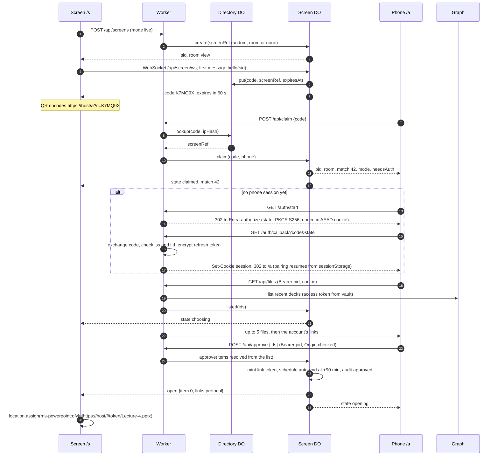
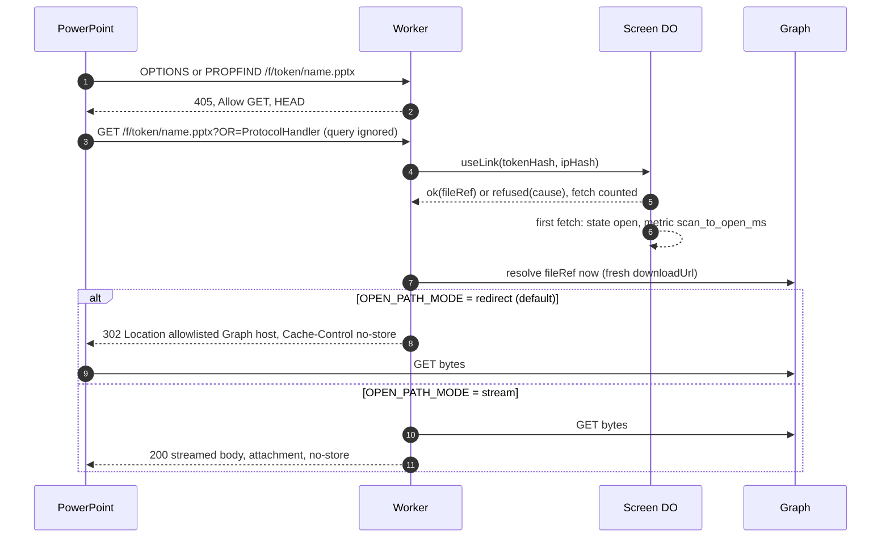

# bloop architecture

Status: draft for review. The stack is fixed by [ADR 0001](adr/0001-stack.md). The choices it leaves open are settled in ADRs 0002 to 0008. Contracts are in [interfaces.md](interfaces.md), and threats in [threat-model.md](threat-model.md).

## 1. What the system does

A room PC's browser shows `/s`, with a QR code and a typed code. A phone scans or types the code, which locks the pairing to that phone. The phone shows the room name and a 2-digit match code. The user picks one file, from OneDrive or as a guest upload, and taps Approve. The screen then gets one short-lived link, `https://<host>/f/<token>/<name>.pptx`, and opens it with `ms-powerpoint:ofv|u|<link>`. If that fails it falls back to a download, and after that to a labeled PDF view. The session ends from the phone, from the screen, or by itself after 90 minutes.

Invariants (each one is enforced in code and proven by a test in the threat model):

1. The screen holds a screen credential (`sid`) and the links of the current session, never an account, a cookie for an account, or a Microsoft token.
2. Each code works once and lasts 60 s, plus a 10 s grace after its successor appears.
3. One session gets one file. A link names that file only, and dies when the session ends.
4. Every secret that travels in a URL is short-lived, single-purpose, and stored only as a hash.
5. Demo sessions never touch the token vault or a real file source.

## 2. Context (C4 level 1)

```mermaid
flowchart LR
  user([Presenter or guest, with a phone])
  admin([IT or AV admin])
  pc[Room PC: a browser on /s, plus installed PowerPoint]
  bloop[bloop: pairs a phone with a screen and hands the screen one file link]
  entra[Microsoft Entra ID]
  graph[Microsoft Graph and OneDrive]
  user -- "scan, sign in once, choose, approve, end" --> bloop
  pc -- "shows codes, receives one link" --> bloop
  pc -- "PowerPoint fetches /f/ link" --> bloop
  bloop -- "OAuth code flow with PKCE" --> entra
  bloop -- "list recent decks, resolve download URL" --> graph
  pc -. "redirect mode: PowerPoint downloads from Graph" .-> graph
  admin -- "reads /security, exports audit" --> bloop
```

## 3. Containers (C4 level 2)

```mermaid
flowchart TB
  subgraph browser[Browsers]
    s["/s screen page"]
    a["/a, /code, /g phone pages"]
    l["/ landing, /security, /privacy"]
  end
  subgraph cf[Cloudflare account, one Worker, one origin]
    assets[Static assets: public/ served directly, headers from public/_headers]
    w[Worker: fetch handler with URLPattern routes, plus scheduled handler]
    scr[(Screen Durable Object, one per screen, SQLite, hibernating WebSockets, one alarm)]
    dir[(Directory Durable Object, one instance: typed code to screen, guess counters)]
    d1[(D1, eu: users, grants, sessions, audit, metrics, rooms)]
    r2[(R2, eu: guest files, 1-day lifecycle rule)]
    rl[Rate-limit bindings]
    sec[Secrets: KEKs, Entra client secret, pepper, cookie key]
  end
  s & a & l -->|GET pages| assets
  s & a & l -->|"/api/*, /auth/*"| w
  ppt[PowerPoint on the PC] -->|"/f/*"| w
  w --> scr
  w --> dir
  w --> d1
  w --> r2
  w --> rl
  scr --> d1
  scr --> r2
  w -->|token endpoint| entra[Entra ID]
  w -->|Graph API| graph[Graph]
```

| container    | owns                                                                                                                     | does not own                                                        |
| ------------ | ------------------------------------------------------------------------------------------------------------------------ | ------------------------------------------------------------------- |
| Worker       | routing, header policy, Origin checks, validation (Zod), OAuth, token vault, Graph calls, `/f/` serving, retention cron  | session state (that lives in the Screen object)                     |
| Screen DO    | the state machine of one screen: codes, pairing, the approved file, links, timers, both sockets, exact per-screen limits | anything that outlives a session, except audit rows it writes to D1 |
| Directory DO | typed code to `screenRef` routing, global failed-lookup counters per hashed IP                                           | session state                                                       |
| D1           | long-lived records (section 8)                                                                                           | live pairing state                                                  |
| R2           | guest file bytes during one session                                                                                      | anything else                                                       |

Every Durable Object namespace is used through `namespace.jurisdiction("eu")`. Why there are two DO classes: ADR 0002.

## 4. Flows

### 4.1 Pairing, approve and open (OneDrive)


Phone page loads strip the code from the address bar with `history.replaceState` before any other script runs.

### 4.2 Open path (`/f/`)


The Worker answers a `/f/` request in this order: the platform rate limit, the token's shape, the Screen object's link rules (`useLink`), the source (`resolve`, or `resolvePdf` for a PDF link), then the OpenPath answer. A token that is malformed, unknown, or from a screen that no longer exists is the same 404. A source with no download URL (the mock, guest files) streams in either mode, with `Content-Length` when the size is known. HEAD answers from the metadata and counts as a fetch, as GET does. Range requests are not supported (T3 records whether Office sends them).

The screen reports `launched` once. If no fetch arrives within 5 s of the launch, the screen shows Download It Instead; Download mints a fresh link for the same approved file, or for the item the request names (`POST /api/screen/link`, at most 5 per item), and the fetch of it moves the session to `open` with `openMode: download`, which both pages show as "PowerPoint didn't open.". There the screen also offers Show as PDF Instead, which mints the `pdf` link and opens it in a second window. A launch made without user activation also shows an Open button, whose click launches again: the browser may refuse an external-protocol launch that no gesture caused (field check T3). After a reload, an approved screen that gets no `open` frame asks for the protocol link itself. A fetch of any link, whatever its purpose, is the first accepted fetch. ADR 0003 covers the details.

### 4.3 End and auto-end


Backstops: an hourly cron ends any D1 `session` row still open 95 minutes after approval or claim (`closeStaleSessions`, `end_reason` `auto`), and lists `g/` in the bucket and deletes any guest object older than 2 hours, closing the matching `guest_file` rows. The R2 lifecycle rule (`tools/r2-lifecycle.json`, applied by `deploy.yml`) deletes anything under `g/` older than 1 day.

### 4.4 Guest drop (host absent)

The default needs no host and no sign-in. The Open click on the screen is the proof that someone is at the lectern.

1. The guest scans the screen's code (or types it). `POST /api/claim {code}` locks the pairing to that phone, as for anyone. The scan does not say who is scanning, so the phone shows its usual choice, with "Send a File Instead" as a text action where there is nothing to choose from (and beside Approve). A claim made with `kind: "guest"` goes straight to the guest's choose state.
2. The phone shows the guest states (choose, confirm, sending, refused: design.md section 7), checks the extension and size itself, and sends the file with `PUT /api/drop` (Bearer pid, `Origin`, `Content-Length` required, `X-Bloop-Name`). The Worker checks the declared length and name, and asks the Screen DO to begin: the DO applies the room's policy, refuses a second file with `already_uploaded`, checks the cap (`too_large`) and moves the session to `uploading`; an owner claim becomes a guest here. The Worker then reserves budget in D1 (`storage_full`), streams the body to R2 through a fixed-length stream and a digest, and validates by range reads (head, zip central directory or PDF tail). The only inflate is the small `[Content_Types].xml` part.
3. Valid: the Worker tells the Screen DO (`dropDone`), which moves to `offered`. Nothing opens yet. The screen shows the file name with an "Open" button (string `guest_open`: heading "{file name}", line "Sent by a guest. Open it here when you're ready.", control "Open"); the phone shows "Sent to {room}." Invalid or failed: the object is deleted, the DO returns to `claimed` (`dropFailed`), and the phone shows "This file can't be sent." (or the cause's state: `busy` for `storage_full`, an error for an aborted upload).
4. A click on the screen's Open button sends `open.click` on the screen socket. The Screen DO moves to `approved`, and the open path runs as in 4.2, served from R2. The file opens in PowerPoint (`.pptx`) or the browser PDF viewer (`.pdf`). The click also supplies the user gesture that launching `ms-powerpoint:` likely needs (T3). An offer nobody clicks expires after `CLAIM_TIMEOUT_SECONDS`, and the object is deleted.
5. At end, the object is deleted (4.3): by the Screen DO's `purge` seam, which deletes by the file's key when the session holds the file and by session id when an upload had no ref yet (a cancel, Start Over or timeout mid-upload), marks `guest_file.deleted_at`, and audits `guest.deleted`. A route that finds its session gone when the bytes land deletes the object itself.

Per-room policy (ADR 0005): `open` (default) is the flow above. `pass` is optional and IT turns it on per room: the host signs in on their phone and creates a guest link (`POST /api/guest-passes`, `https://<host>/g#p=<pass>`, 24 h, one session; the pass sits in the fragment, so it never reaches a server log). The guest opens `/g`, which keeps the pass in `localStorage`, and sends it with the claim (`POST /api/claim {code, pass}`). The screen-side Open click still applies. `off` refuses drops.

### 4.5 Demo

`/s?mode=demo`, entered from the landing, opens a demo screen (`POST /api/screens {mode: "demo"}`). Differences from the live flow:

- the file source is always `MockFileSource`, fixed at screen creation on the server. A client cannot switch it. The demo account lists Sample deck.pptx, Sample deck.pdf (the deck's export, and its rendition), Dog.jpg and one link, Vevox (interfaces.md section 3); the phone approves any of them as one list;
- the screen launches nothing: no `ms-powerpoint:` and no `window.open`. On the launch link it fetches the link itself (a HEAD, as PowerPoint would; an image's view link it shows as the image instead), which moves the session to `open`, and from `approved` to `open` it shows every approved item in a viewer in the page (`public/js/viewer.js`), built from the screen's state (`demo_open`), so a reload or a dropped socket shows it again: a sidebar of the items, and the chosen one on the stage. The sample deck and its PDF show as pre-rendered slide images (`public/img/demo-slide-*`, `tools/render-slides.py`; prev and next, arrow keys, swipe, Present), an image as itself (another item's view link is minted with `protocol` and that item), a link as a card that opens it in a new tab, and any other file, a guest's included, as a card. Download mints a fresh download link for the shown item on the click;
- one device can play both parts: in the waiting state the demo screen offers "Approve on This Device", a same-tab link to `/a?c=<code>`; `/a` then offers "See It on the Screen" back to `/s?mode=demo`, which resumes the screen from the sid in that tab's `sessionStorage`. Only the tab that created a screen holds its sid, and a stored sid resumes only a screen of the page's mode. A demo screen runs at phone width; a live one asks for the room's screen;
- the phone gets no OAuth step, and demo routes never read the phone session cookie;
- the session lasts 60 min (`DEMO_SESSION_MINUTES`), and guest drops are capped at 10 MB (`DEMO_GUEST_MAX_BYTES`), and the Open click applies as in 4.4;
- the demo has its own rate limits (section 6): stricter per-IP bindings for creating and claiming, and a global cap on concurrent demo screens held in the Directory (`DEMO_MAX_CONCURRENT`) and a per-IP-hash cap (`DEMO_MAX_PER_IP`) so one address cannot fill it. A demo screen takes a slot at creation, for one claim window plus one session, and gives it back when its session ends or the screen closes; a screen that outlives its hold stops counting. `DEMO_ENABLED=false` makes `POST /api/screens {mode: "demo"}` and any claim of a demo code answer `not_found`;
- its session and audit rows are `mode = demo` with no user, and are kept 7 days;
- the landing embeds no demo: its Try the demo button opens `/s?mode=demo`, and the landing's hero stage is a static panel, with no connection.

ADR 0007 covers this.

## 5. Repo layout

One npm package. Runtime dependencies: the list in ADR 0001.

```
package.json  package-lock.json  wrangler.jsonc  biome.json
tsconfig.json              Worker + shared, strict, workers-types
tsconfig.node.json         tests and tools, node types (the two type sets clash if mixed)
tsconfig.public.json       checkJs over public/ (JSDoc), DOM lib, imports types from src/shared via @import
vitest.config.ts  vitest.int.config.ts  playwright.config.ts  lighthouserc.json  .htmlvalidate.json
.dev.vars.example
migrations/                0001_init.sql, numbered, raw SQL (wrangler d1 migrations)
src/shared/
  protocol.ts              type-only contracts: messages, views, error codes (never served; browser JS imports them through JSDoc @import)
src/worker/
  index.ts                 fetch + scheduled entry, route table
  http.ts                  json(), problem(), origin and fetch-metadata checks, body limits
  headers.ts               the header policy; applied to every Worker response
  config.ts                Zod schema for env, fails closed at startup
  do/demo-slots.ts         the global cap on concurrent demo screens (SQL in the Directory object)
  machine.ts               pure session state machine (interfaces.md)
  items.ts                 the session's items: types, MAX_ITEMS, order, the link allowlist (ADR 0009)
  do/schema.ts             the Screen object's numbered storage steps (schemaVersion)
  do/screen.ts  do/directory.ts
  seams/file-source/{index,mock,demo,graph}.ts   interface; MockFileSource; the bundled demo account; GraphFileSource
  source-access.ts         which source serves a screen (mode and FILE_SOURCE), and the server-side resolve of an approved id
  seams/open-path/{index,redirect,stream,select,links}.ts   OpenPath interface; the 302 and the streaming answer; the mode switch; link minting, life rules, client class
  do/ledger.ts             the per-screen link record (hashes and counters, revoked tombstones)
  seams/guest-drop/{index,select,r2,purge,validate,zip}.ts   GuestDrop interface and limits; the one place that picks R2; the R2 and D1 ledger adapter; deletion at session end; type and structure checks; zip directory reader
  audit.ts audit-d1.ts   AuditLog interface and the D1 store (one row per event, session row mirror, export stream, purge, erasure)
  metrics.ts metrics-d1.ts   Metrics interface, percentile and ISO-week math, and the D1 store (events, rollup, summary)
  export-format.ts         CSV with formula-injection protection, export columns, date range parsing
  stores.ts                the one place that picks the AuditLog and Metrics implementations
  auth/{oauth,vault,sessions,cookies,services,db}.ts   oauth4webapi flow; token vault; phone sessions; cookie format and AEAD seal; per-request objects and the daily job; the D1 slice
  routes/{pairing,files,open,drop,auth,export,common}.ts
  retention.ts             cron jobs: closeStaleSessions (hourly), runRetention (daily)
public/                    wrangler's assets directory, served as it is. Everything here is public: no secrets, no server-only logic
  index.html security.html privacy.html s.html a.html code.html 404.html   (the /g and /me pages are not built yet)
  _headers                 static security headers (section 10)
  _redirects               /it answers 301 to /security
  css/app.css              the one stylesheet (task pages and site pages)
  js/{screen,phone,code,launcher,residue}.js   task pages; js/vendor/uqr.js (+ LICENSE)
  js/viewer.js js/core/demo.js   the demo screen's viewer (sidebar, stage, pager, link card, its own link fetch); its pure parts
  img/demo-slide-{n}.{avif,webp}   the sample deck's pages, shown for the deck and its PDF (tools/render-slides.py)
  js/site.js               the landing: the nav's scrolled look, closing the menu on a same-page link, the FAQ's height tween where CSS cannot (no other site page runs a script)
  og.png apple-touch-icon.png (tools/render-og.py); favicon.svg, the logo, drawn as paths
  fonts/inter-latin.woff2  the one font file (tools/subset-font.py) + Inter.LICENSE.txt
  js/shared/               runtime code shared by browser and Worker: plain JSDoc-typed ES modules
    codes.js               code alphabet, normalize, format "K7M Q9X" (pure)
    names.js               the /f/ link's name segment: an ASCII slug (pure)
    errors.js              error code to HTTP status and user-facing state (pure)
  .well-known/security.txt
src/fonts/InterVariable.woff2   the source of the font subset, never served
tools/
  make-fixtures.mjs        writes the synthetic sample decks the tests use
  render-slides.py         the demo deck's PDF export to the demo screen's slide images
  change-tier.mjs          classifies the staged diff (T0 to T2) and enforces the commit-msg blocks
  render-og.py og.svg      the social image and the touch icon, from the logo; og.svg is the image's SVG source
  subset-font.py           Inter to the Latin subset, wght 400 to 600, opsz kept
test/
  unit/                    vitest + fast-check: machine, codes, names, zip, vault, csv, headers
  integration/             against a real wrangler dev (wrangler.ts starts one on a free port): every route, sockets, timers, threat tests
  e2e/                     Playwright, two contexts (screen, phone), axe, CI only
  fixtures/decks/          synthetic sample decks (written by tools/make-fixtures.mjs), later polyglots, zip bombs, macro decks
  fixtures/graph/          synthetic Graph JSON for the contract tests (README says so)
  fixtures/jsdoc/          a good and a bad browser module, proving JSDoc @import of protocol.ts is type-checked
```
`.wrangler/` is gitignored. There is no copy or build step for assets: `wrangler.jsonc` sets `assets.directory` to `./public`. The Worker imports `public/js/shared/*.js` by relative path, and wrangler's own esbuild bundles it. Type-only contracts stay in `src/shared/*.ts` so they are never served.

## 6. Routes

`run_worker_first: ["/api/*", "/f/*", "/auth/*"]`. Everything else is a static asset (`html_handling: "drop-trailing-slash"`, so `/s` serves `s.html`).

| method                   | path                                         | auth                                  | purpose                                                        |
| ------------------------ | -------------------------------------------- | ------------------------------------- | -------------------------------------------------------------- |
| GET                      | `/`, `/security`, `/privacy`, `/s`, `/a`, `/code`, `/g`, `/me`, `/.well-known/security.txt` | none (static) | pages; `/it` answers 301 to `/security`; any other path is `404.html` with status 404 |
| POST                     | `/api/screens`                               | none, or room cookie (registered)     | create a screen: `{mode}` to `{sid, room}`                     |
| GET                      | `/api/screen/ws?ref=<screenRef>`             | `hello{sid}` as first message, Origin | screen socket (the ref only routes to the object; it is no secret) |
| GET                      | `/api/screen/state`                          | Bearer sid                            | polling fallback; also the rotation clock when there is no socket. A poll writes nothing unless a code is due or the close deadline is a tenth of its window stale |
| POST                     | `/api/screen/restart`                        | Bearer sid                            | "Start Over" on the screen: drop an unapproved claim, new code |
| POST                     | `/api/screen/link`                           | Bearer sid                            | one more link for an approved file `{purpose: protocol, download, pdf or view, item?}` to `{item, links}` (`item` defaults to the first file; a link item is `file_not_found`); counts against that item's `LINK_MINTS_PER_ITEM`; `protocol` only from `approved` (the screen lost its link) |
| POST                     | `/api/screen/end`                            | Bearer sid                            | end; response carries `Clear-Site-Data: "storage"`             |
| POST                     | `/api/claim`                                 | none; rate-limited                    | `{code, pass?, kind?}` to `{pid, room, match, mode, kind, needsAuth, dropMaxBytes}` |
| GET                      | `/api/pair/ws?ref=<screenRef>`               | `hello{pid}`, Origin                  | phone socket                                                   |
| GET                      | `/api/pair/state`                            | Bearer pid                            | polling fallback                                               |
| GET                      | `/api/files`                                 | Bearer pid, plus session cookie when `FILE_SOURCE=graph` and the screen is live | up to 5 recent files, then the account's links, as `{items: Entry[]}`; tells the Screen object the ids shown |
| POST                     | `/api/approve`                               | Bearer pid, plus cookie as above, Origin | `{ids}`, 1 to 12 distinct entry ids; the Worker resolves each item from the source's list, so an id not in it is `file_not_found` |
| PUT                      | `/api/drop`                                  | Bearer pid, Origin                    | guest upload, raw body, `X-Bloop-Name` (percent-encoded), `Content-Length` required, octet-stream, PDF or PPTX content type; answers the phone's view (`offered`) |
| POST                     | `/api/cancel`                                | Bearer pid, Origin                    | cancel before approve                                          |
| POST                     | `/api/end`                                   | Bearer pid, Origin                    | end from the phone                                             |
| POST                     | `/api/guest-passes`                          | session cookie, Origin                | host creates a guest link                                      |
| GET                      | `/api/me`                                    | session cookie                        | `{source, signedIn, email}`; with `FILE_SOURCE=mock` it is `{source: "mock", signedIn: true, email: null}` |
| POST                     | `/api/me/signout`                            | session cookie, Origin                | delete this session, clear the cookie; the grant stays         |
| GET                      | `/api/me/audit`                              | session cookie                        | `{rows, next}`: the user's own audit rows, newest first, `limit` (1 to 200, default 50) and `before` (the `at` of the last row) for the next page; `next` is null on the last page. Grant rows are about the account, so their `sessionId` is `user:<id>` |
| POST                     | `/api/me/disconnect`                         | session cookie, Origin                | delete the grant and every session of the user                 |
| DELETE                   | `/api/me`                                    | session cookie, Origin                | erase the user (DATA-05): `user.erased` is recorded first (a failed record means nothing is erased), then audit rows are anonymized (user id and file name dropped, grant rows re-scoped to `erased`), then the user row goes and cascades the grant and every session |
| GET                      | `/api/it/export`                             | Bearer IT export token; 401 while unset | `?format=json` (default) or `csv`, `&data=audit` (default) or `metrics`, `&from&to` as UTC days (default last 30, at most 366); 400 otherwise; `attachment`, `no-store` |
| POST                     | `/api/rooms/enroll`                          | enrollment key in body, Origin        | sets the room cookie on a lectern (ADR 0008)                   |
| GET                      | `/api/health`                                | none                                  | status line probe, no state                                    |
| GET                      | `/auth/start`                                | none; 10 per 60 s per IP              | 302 to Entra; no return parameter exists                       |
| GET                      | `/auth/callback`                             | AEAD state cookie                     | code exchange, then 302 to `/a` (fixed). 400 `bad_request` for a state, cookie or expiry failure (no cookie set), 403 `consent_declined` or `admin_consent_required` for an Entra refusal, 401 `unauthorized` when the ID token fails validation, 502 `source_unavailable` for a failed exchange. Every failure is a small HTML page in the design voice (`auth/error-page.ts`, app policy), never raw problem+json, because the callback is a top-level navigation |
| GET, HEAD                | `/f/:token/:name`                            | the token                             | open path; query string and name ignored; 404 for any unknown or malformed token, 410 for a dead one |
| OPTIONS, PROPFIND, other | `/f/*`                                       | none                                  | 405 `Allow: GET, HEAD`                                         |

Every state-changing route checks four things: `Origin` equals `PUBLIC_ORIGIN`; `Sec-Fetch-Site` is `same-origin` when present; `Content-Type: application/json` (or the declared upload type); and a Zod-parsed body. Bearer credentials come from `sessionStorage` and travel in `Authorization`, never in a URL. Errors are `application/problem+json` with an `ErrorCode` (interfaces.md). A POST with no fields still sends `Content-Type: application/json` and a body of `{}` (or no body): that header is what turns a cross-site form post into a 415. Bodies are at most 4 KB, and Zod schemas refuse unknown keys. `POST /api/claim` takes `{code, pass?, kind?}`: `kind` defaults to `owner`, and a phone that wants the guest drop path sends `guest`. A `pass` is refused with `pass_invalid` until guest passes exist.

### Rate limits

| where                   | limit                                                                                | kind                |
| ----------------------- | ------------------------------------------------------------------------------------ | ------------------- |
| `POST /api/screens`     | 10 per 60 s per IP                                                                   | binding             |
| `POST /api/claim`       | 20 per 60 s per IP                                                                   | binding             |
| failed code lookups     | 10 per 10 min per hashed IP, then 429 until the window (10 min from the first miss) ends; a global alarm at 1,000 per 10 min across all hashes (one `pair.miss_alarm` log line; it blocks nobody) | exact, Directory DO |
| next code on one screen | 6 per min                                                                            | exact, Screen DO    |
| `/f/`                   | 60 per 60 s per IP; per link: 10 fetches                                             | binding; exact      |
| `PUT /api/drop`         | 5 per 60 s per IP (every attempt past the Origin and credential checks counts); one accepted file per session; live bytes under `GUEST_STORAGE_BUDGET_BYTES` | binding; exact; D1  |
| `/auth/start`           | 10 per 60 s per IP                                                                   | binding             |
| `GET /api/files`        | 20 per 60 s per session (`RL_FILES`, keyed by the screen ref), after the credential check: each call is a Graph call | binding |
| `/api/it/export`        | 10 per 60 s per IP, checked before the token (a per-token key would not slow guessing) | binding             |
| demo screen creation    | per IP (`RL_DEMO_CREATE` in `wrangler.jsonc`), instead of the live limit             | binding             |
| demo claims             | per IP (`RL_DEMO_CLAIM`), after the lookup says the code is a demo one; the live claim limit applies first, so the lower of the two binds | binding |
| concurrent demo screens | `DEMO_MAX_CONCURRENT` across all visitors, and `DEMO_MAX_PER_IP` per IP hash (values in `wrangler.jsonc`); the next create answers 429 `rate_limited` | exact, Directory DO |
| demo screens            | plus a 60-min session and a 10 MB drop cap                                           | config              |

IPs are never stored. Limits use `HMAC(HASH_PEPPER, ip)` of `CF-Connecting-IP` (Cloudflare sets it; a local run has none and shares one key), kept only in DO storage until the window ends. The rate-limit bindings run in `wrangler dev` too. `TEST_TIMING=1` skips them so one integration run can create more screens than the per-IP limit allows; the exact limits in the objects stay on.

## 7. WebSocket protocol

Both sockets are JSON text frames of at most 4 KB, `{"v":1,"t":<type>,...}`. A socket that fails to send a valid `hello` within 5 s (the object's alarm closes it, after an `error` frame), sends an unknown type, or sends an oversized frame is closed with 1008. A phone socket is closed with 1000 when its pairing is dropped (after `error pairing_invalid` for a cancel, Start Over or timeout). The upgrade is refused (403) unless `Origin` equals `PUBLIC_ORIGIN`, and (400) unless it carries a well-formed `?ref=`. The deadline is stored in the socket attachment and the object keeps one alarm at the earliest of it and the machine's next deadline, so it survives hibernation. `wrangler dev` writes the close frame on time but never closes the TCP connection after the handshake, so Node's `WebSocket` never fires `close` for it; the integration test reads the frames off a raw socket instead. Heartbeats use the DO auto-response (`ping` to `pong`), so they never wake the object. Clients reconnect after 1, 2, 5, 10 and then 30 s, and fall back to polling the `state` route every 3 s after 3 failed reconnects. Every server message carries `now` (server epoch ms), so countdowns survive clock skew. Exact types are in interfaces.md (`ScreenMsgIn`, `ScreenMsgOut`, `PhoneMsgIn`, `PhoneMsgOut`).

| direction        | type        | body                                                                                |
| ---------------- | ----------- | ----------------------------------------------------------------------------------- |
| screen to server | `hello`     | `sid`                                                                               |
|                  | `code.next` | none (also sent when the tab becomes visible)                                       |
|                  | `launched`  | `mode: protocol or pdf`, sent once, at the first launch (any other state ignores it) |
|                  | `ping`      | none                                                                                |
| server to screen | `state`     | `ScreenView` (state, room, code, match, items, endsAt)                              |
|                  | `open`      | `item` and `links: {protocol, download, pdf, view}`, one field set per mint (sent once per mint; never repeated in `state`) |
|                  | `error`     | `code: ErrorCode`                                                                   |
| phone to server  | `hello`     | `pid`                                                                               |
| server to phone  | `state`     | `PhoneView` (state, room, match, items, endsAt for the countdown, mode, kind)       |
|                  | `error`     | `code`                                                                              |

Phone actions (approve, cancel, end, upload) and screen actions that change a session (end, link, restart) use HTTP, so they get the Origin check, idempotency and a clear status. The sockets only push state.

## 8. Data model

### 8.1 D1 (`eu` jurisdiction), `migrations/0001_init.sql`

```sql
-- ids are 128-bit random, base64url; *_hash columns are SHA-256 of a secret, never the secret
CREATE TABLE org (id TEXT PRIMARY KEY, name TEXT NOT NULL, created_at INTEGER NOT NULL);

CREATE TABLE room (                     -- registered screens (ADR 0008); kept until deleted by IT
  id TEXT PRIMARY KEY, org_id TEXT NOT NULL REFERENCES org(id),
  name TEXT NOT NULL,                    -- "Room 2.14", shown on the phone
  screen_ref TEXT NOT NULL UNIQUE,       -- routes to the room's Screen DO
  key_hash TEXT NOT NULL, key_kid INTEGER NOT NULL, key_rotated_at INTEGER NOT NULL,
  allowed_cidrs TEXT,                    -- JSON list or NULL
  guest_policy TEXT NOT NULL DEFAULT 'open' CHECK (guest_policy IN ('off','pass','open')),
  link_binding TEXT NOT NULL DEFAULT 'log' CHECK (link_binding IN ('off','log','enforce')),
  created_at INTEGER NOT NULL);

CREATE TABLE app_user (                   -- kept while a grant or session exists, then 30 days
  id TEXT PRIMARY KEY,
  tid TEXT NOT NULL, oid TEXT NOT NULL,  -- Entra tenant and object id: the identity key
  email TEXT,                            -- shown in audit and /me
  org_id TEXT REFERENCES org(id),
  created_at INTEGER NOT NULL, last_seen_at INTEGER NOT NULL,
  UNIQUE (tid, oid));

CREATE TABLE token_grant (                 -- deleted on disconnect, erase, or GRANT_IDLE_DAYS unused
  user_id TEXT PRIMARY KEY REFERENCES app_user(id) ON DELETE CASCADE,
  kid TEXT NOT NULL,                     -- KEK that wraps dek
  dek_wrapped BLOB NOT NULL,             -- AES-KW of the per-user data key
  rt_ct BLOB, rt_iv BLOB,                          -- refresh token (NULL in TOKEN_MODE=session), AES-256-GCM, AAD = user_id|version|rt
  at_ct BLOB, at_iv BLOB, at_exp INTEGER,          -- cached access token, at most 1 h
  scope TEXT NOT NULL, folder_id TEXT,   -- folder_id: the only folder listed (NULL: the drive root)
  version INTEGER NOT NULL,              -- compare-and-swap on refresh
  updated_at INTEGER NOT NULL);          -- last use, the GRANT_IDLE_DAYS clock

CREATE TABLE phone_session (             -- 30 days idle, 90 days absolute
  id_hash TEXT PRIMARY KEY, user_id TEXT NOT NULL REFERENCES app_user(id) ON DELETE CASCADE,
  created_at INTEGER NOT NULL, last_seen_at INTEGER NOT NULL, expires_at INTEGER NOT NULL);

CREATE TABLE guest_pass (                -- 24 h, then deleted by the daily job
  id_hash TEXT PRIMARY KEY, host_user_id TEXT NOT NULL REFERENCES app_user(id) ON DELETE CASCADE,
  room_id TEXT REFERENCES room(id), expires_at INTEGER NOT NULL, used_session_id TEXT);

CREATE TABLE session (                   -- AUDIT_RETENTION_DAYS (demo: DEMO_RETENTION_DAYS)
  id TEXT PRIMARY KEY, screen_ref TEXT NOT NULL, room_id TEXT REFERENCES room(id),
  mode TEXT NOT NULL CHECK (mode IN ('live','demo')),
  kind TEXT NOT NULL CHECK (kind IN ('owner','guest')),
  user_id TEXT REFERENCES app_user(id) ON DELETE SET NULL, guest_pass_hash TEXT,
  claimed_at INTEGER NOT NULL, approved_at INTEGER, first_open_at INTEGER, ended_at INTEGER,
  end_reason TEXT, open_mode TEXT, source TEXT, file_name TEXT);

CREATE TABLE audit_event (               -- AUDIT_RETENTION_DAYS (demo: DEMO_RETENTION_DAYS)
  id INTEGER PRIMARY KEY, session_id TEXT NOT NULL, at INTEGER NOT NULL,
  actor TEXT NOT NULL CHECK (actor IN ('screen','phone','system','host','it')),
  type TEXT NOT NULL, detail TEXT NOT NULL DEFAULT '{}');  -- JSON; never tokens, URLs or IPs

CREATE TABLE metric_event (              -- METRICS_RETENTION_DAYS, then rolled into metric_daily
  id INTEGER PRIMARY KEY, at INTEGER NOT NULL, mode TEXT NOT NULL, kind TEXT NOT NULL,
  room_id TEXT, name TEXT NOT NULL, ms INTEGER, cause TEXT);   -- no user, no file name

CREATE TABLE metric_daily (              -- 2 years; counts only
  day TEXT NOT NULL, mode TEXT NOT NULL, name TEXT NOT NULL, cause TEXT NOT NULL DEFAULT '',
  n INTEGER NOT NULL, p50_ms INTEGER, p90_ms INTEGER, PRIMARY KEY (day, mode, name, cause));

CREATE TABLE metric_user_week (          -- 120 days; pseudonym = HMAC(HASH_PEPPER, user_id)
  pseudonym TEXT NOT NULL, iso_week TEXT NOT NULL, PRIMARY KEY (pseudonym, iso_week));

CREATE TABLE guest_file (                -- row: 30 days after deleted_at; object: session end
  session_id TEXT PRIMARY KEY, r2_key TEXT NOT NULL, bytes INTEGER NOT NULL,
  type TEXT NOT NULL CHECK (type IN ('pptx','pdf')), sha256 TEXT NOT NULL,
  name TEXT NOT NULL, created_at INTEGER NOT NULL, deleted_at INTEGER);

CREATE TABLE r2_ops (                    -- R2 operations bloop performed; 13 months (migration 0002)
  month TEXT NOT NULL, class TEXT NOT NULL CHECK (class IN ('A','B')), n INTEGER NOT NULL,
  PRIMARY KEY (month, class));          -- month 'YYYY-MM' UTC; A = put, list; B = get, head
```

### 8.2 Screen Durable Object storage (all deleted at session end, or with `deleteAll()` at close)

| key                | holds                                                                                                                            | lifetime                                                       |
| ------------------ | -------------------------------------------------------------------------------------------------------------------------------- | -------------------------------------------------------------- |
| `meta`             | `screenRef`, mode, room id and name, `screenSecretHash`, created                                                                 | until the screen closes (10 min with no socket and no session) |
| `machine`          | the whole pure-machine record (`src/worker/machine.ts`): state, current and previous code (value, issuedAt, expiresAt, consumed), code request times, pairing (session id, secret hash, kind, match, claimedAt, listed ids, pass hash, user id), session (the approved items in order, approvedAt, endsAt, open mode, mints per item index), deadlines, end reason, open socket count | rewritten on every transition; pairing and session fields are dropped at end |
| `schemaVersion`    | the storage version (`do/schema.ts`); an object on an older one is stepped forward when it wakes | until the screen closes |
| `links`            | per link: `tokenHash`, purpose, item index, mintedAt, firstFetchAt, fetches, revoked. At end every record is marked revoked and kept, so a holder of a real token gets 410 while a guess gets 404 | until the screen closes |
| `screenIp`         | HMAC of the IP the screen's socket connected from, for the link binding check (ADR 0003)                                         | until the screen closes                                        |
| socket attachments | `{role, authed}`                                                                                                                 | the socket's life                                              |

### 8.3 Directory Durable Object storage

| key             | holds                        | lifetime                           |
| --------------- | ---------------------------- | ---------------------------------- |
| `code:<code>`   | `screenRef`, expiresAt       | 70 s, then kept 5 min so a late phone gets `code_expired`; an alarm sweeps older rows |
| `miss:<ipHash>` | failed lookups, window start | 10 min                             |
| `miss:global`   | failed lookups this window, all IP hashes (same table, key `global`) | 10 min                             |

Both objects use SQLite storage: the Screen object through its synchronous key-value API (`ctx.storage.kv`), the Directory through SQL tables `code` and `miss`.

### 8.4 Screen browser

| storage                         | holds                                              | cleared                                          |
| ------------------------------- | -------------------------------------------------- | ------------------------------------------------ |
| `sessionStorage["bloop.sid"]`   | the screen credential                              | at end (with a new one issued), and on tab close |
| memory                          | current links                                      | at end                                           |
| room cookie `__Host-bloop_room` | registered rooms only: room id plus key (ADR 0008) | rotated by IT                                    |

## 9. Configuration and secrets

The Worker's variables are listed once, in `src/worker/config.ts`: the Zod schema parses them, fails closed on a bad value, and gives each one its meaning in a `.describe()`. Defaults are in the schema; the values a deployment sets are in `wrangler.jsonc` `vars`. Secrets are set with `wrangler secret put` (`docs/setup.md`), and `.dev.vars.example` holds fake local values for them. `test/unit/docs-drift.test.ts` fails if those three drift apart. `ROOM_ENROLL_KEY` (registered screens, ADR 0008) is in `.dev.vars.example` but not parsed yet.

`TEST_TIMING=1` is test-only and never set in a deployment (`config.ts` refuses it unless `PUBLIC_ORIGIN` is a local address). The integration tests set it through `startPairing()` in `test/integration/pairing-client.ts`, with short timings such as `CODE_TTL_SECONDS=2` and `SESSION_MAX_MINUTES=0.05`.

Deploy-only values (`CLOUDFLARE_ACCOUNT_ID`, `CLOUDFLARE_API_TOKEN`) are GitHub environment secrets read by `.github/workflows/deploy.yml`, never by the Worker; there is no `.env` file. `BLOOP_PREVIEW_URL`, for the post-deploy header grade, is not wired yet: `deploy.yml` does not read it. Token scopes: `docs/setup.md`.
Bindings in `wrangler.jsonc` (not env vars): `ASSETS`, `SCREEN` and `DIRECTORY` (Durable Objects, SQLite classes), `DB` (D1, `eu`), `GUEST_FILES` (R2, `jurisdiction: "eu"`), `RL_CREATE`, `RL_CLAIM`, `RL_FETCH`, `RL_UPLOAD`, `RL_AUTH`, `RL_EXPORT`, `RL_FILES` (rate limits), and two crons (`0 * * * *` hourly backstop, `30 3 * * *` daily retention). The D1 database id in `wrangler.jsonc` is not a secret.

## 10. Security headers

Static pages get their headers from `public/_headers`. The Worker runs first for dynamic routes (`/api/*`, `/f/*`, `/auth/*`) and sets headers on its own responses through `src/worker/headers.ts`, the one policy module. A unit test asserts that `public/_headers` matches what `headers.ts` produces for static pages, and `csp_evaluator` (dev only) fails CI on any high or medium finding.

Every response:

```
Strict-Transport-Security: max-age=63072000; includeSubDomains
X-Content-Type-Options: nosniff
Referrer-Policy: no-referrer
Cross-Origin-Opener-Policy: same-origin
Cross-Origin-Resource-Policy: same-origin
Origin-Agent-Cluster: ?1
X-Frame-Options: DENY
Permissions-Policy: accelerometer=(), autoplay=(), browsing-topics=(), camera=(), display-capture=(), encrypted-media=(), fullscreen=(), geolocation=(), gyroscope=(), hid=(), idle-detection=(), magnetometer=(), microphone=(), midi=(), payment=(), publickey-credentials-get=(), screen-wake-lock=(), serial=(), usb=(), xr-spatial-tracking=()
```
`/s` overrides two entries: `fullscreen=(self), screen-wake-lock=(self)`, so a lectern can go full screen and stay awake.

CSP per page type. Every page uses no inline script or style and no HTML string sinks. File names are set with `textContent`, and the QR is built with `createElementNS` and `setAttribute("d", ...)`.

| page                             | Content-Security-Policy                                                                                                                                                                                                                                                               |
| -------------------------------- | ------------------------------------------------------------------------------------------------------------------------------------------------------------------------------------------------------------------------------------------------------------------------------------- |
| landing `/`, `/security`, `/privacy`, `404`, `security.txt` (the `/*` default) | `default-src 'none'; script-src 'self'; style-src 'self'; img-src 'self'; font-src 'self'; connect-src 'self'; manifest-src 'self'; base-uri 'none'; form-action 'none'; frame-ancestors 'none'; require-trusted-types-for 'script'; trusted-types 'none'; upgrade-insecure-requests` |
| screen `/s`                      | `default-src 'none'; script-src 'self'; style-src 'self'; img-src 'self'; font-src 'self'; connect-src 'self'; base-uri 'none'; form-action 'none'; frame-ancestors 'none'; require-trusted-types-for 'script'; trusted-types 'none'; upgrade-insecure-requests`                      |
| phone `/a`, `/code`, `/g`, `/me` | same as `/s`                                                                                                                                                                                                                                                                          |
| `/api/*`, `/auth/*`              | `default-src 'none'; frame-ancestors 'none'`, plus `Cache-Control: no-store`                                                                                                                                                                                                          |
| `/f/*` `.pptx`                   | `default-src 'none'; sandbox; frame-ancestors 'none'`, `Content-Disposition: attachment`, `Cache-Control: no-store`                                                                                                                                                                   |
| `/f/*` PDF view (purpose `pdf`)  | `default-src 'none'; object-src 'self'; frame-ancestors 'none'`, `Content-Disposition: inline`, `Cache-Control: no-store`. `sandbox` is left out because Chromium does not render a PDF in a sandboxed document, and `object-src 'self'` is the one hole because its viewer is an embedded plugin that the `default-src` fallback would block (both unverified, field check F-PDF, ADR 0003) |

`connect-src 'self'` covers `wss:` to the same host under CSP Level 3. A Playwright test asserts that no CSP violation is reported on any page. COEP is not set: nothing on the site needs cross-origin isolation, and it would add a failure mode.

Every `/auth/*` and `/api/me*` route (and the `/api/files` listing for a live Graph screen) answers `source_unavailable` (502) unless `FILE_SOURCE=graph` and the Entra settings are present; `config.ts` already refuses to start on `graph` with a partial configuration, so `source_unavailable` is what a mock deployment returns. With `FILE_SOURCE=mock` the demo account is the user: no sign-in, `needsAuth` is false, and live screens list the same sample decks as demo screens. With `graph`, only a live screen builds `GraphFileSource` and reads the phone cookie; a demo screen ignores a cookie it is sent and always uses the demo account (SRC-04). The claim route resolves the cookie only under `graph`, so a signed-in phone claims with `needsAuth` false.

Cookies: `__Host-bloop_sid` (phone session: a random 256-bit value, only its SHA-256 in `phone_session`; HttpOnly, Secure, SameSite=Lax, Path=/, 90 days; sign-in issues a new value and deletes the presented one), `__Host-bloop_oauth` (state, PKCE verifier and nonce, AES-GCM with `COOKIE_KEY` and the cookie name as AAD, 10 min, SameSite=Lax; cleared by the callback), and `__Host-bloop_room` (registered screens; HttpOnly, Secure, SameSite=Strict).

Logging: Worker logs record the route pattern, status, `ErrorCode` and duration. They never record a URL, header, body, token, code, IP or file name. `http.ts` exposes one `log()` that takes a fixed shape, and a test greps the captured `wrangler dev` output for secrets after the integration run.

## 11. Local development and tests

- `npm run dev`: `wrangler dev --ip 127.0.0.1 --port 8787 --persist-to .wrangler/state`, after `predev` applies `migrations/` to that local D1 (idempotent; the guest drop and the session records need the tables, and the e2e and Lighthouse servers start through it). This needs no Cloudflare login. DO, D1, R2 and the rate-limit bindings run locally, and `FILE_SOURCE=mock`. It serves plain HTTP: browsers treat `localhost` as a secure context, so `__Host-` cookies work. Trying it from a phone on the LAN needs HTTPS (`--local-protocol https`, accepting the self-signed certificate once) and `PUBLIC_ORIGIN` set to that origin.
- Local secrets: `cp .dev.vars.example .dev.vars` (every value is fake).
- `npm run typecheck`: `tsc` for the Worker, for tests and tools (`tsconfig.node.json`), and for the browser JS (`tsconfig.public.json`). `npm run lint`: Biome (markdown is excluded). `npm test`: Vitest unit tests. `npm run check` runs typecheck, lint, test, test:int, html-validate and size-limit. Size budgets are the `size-limit` entries in `package.json`, the only owner.
- `npm run test:int`: each test file starts `wrangler dev` on a free port through `test/integration/wrangler.ts` (`{migrate: true}` applies `migrations/` to its throwaway D1 first; `auth.test.ts` uses that, with a local fake Entra on a free port and `ENTRA_AUTHORITY` set to it) (throwaway state directory, `PUBLIC_ORIGIN` set to that port, torn down after), drives the screen and phone with Node's native `WebSocket` (with an `Origin` header) and `fetch`, and moves time by running the Worker with short timings under `TEST_TIMING=1` (section 9) instead of a clock header: Durable Object alarms use real time. `open.test.ts` and `open-timing.test.ts` cover the open path (mint, fetch, methods, the 11th fetch, short windows, stream mode, fallback links, end). Three files cover pairing: `pairing.test.ts` (flows, validation, CSRF, sockets), `pairing-timing.test.ts` (short timings: expiry, rotation, claim timeout, auto-end, hello timeout) and `pairing-limits.test.ts` (production timing, so the rate-limit bindings and the exact guess limit are live, and a config that fails closed). `wrangler dev` does not implement Durable Object jurisdictions, so `stubs.ts` skips `eu` when `PUBLIC_ORIGIN` is local.
- Task pages (`public/s.html`, `a.html`, `code.html`, `css/app.css`, `js/screen.js`, `phone.js`, `code.js`): pure client logic lives in `public/js/core/` (state mapping `states.js`, every string `copy.js`, `channel.js` for the WebSocket with reconnect 1, 2, 5, 10, 30 s and the 3 s polling fallback, `api.js`, `qr.js`). `/s?mode=demo` opens a demo screen (default `live`). The QR link is `/a?c=<code>`; the phone strips `?c=` with `history.replaceState` when its modules load. `GET /api/files` answers `{files: FileEntry[]}` (`core/files.js` has no fallback: an error is an error). A signed-in live phone shows a Disconnect OneDrive text action (it asks `GET /api/me` once after listing). `public/js/launcher.js` is the screen's launch ladder (the `open` frame, the Download control after 5 s, the PDF view, the Open click when the launch had no user gesture) and `public/js/residue.js` clears the page's state at `ended` and `closed`. Claims marked `[V-n]` in design.md ship only while their flag in `core/verified.js` is true.
- `npm run test:e2e` (CI): Playwright with two browser contexts (screen at 1440, phone at 390), started with `TEST_TIMING=1` and `.dev.vars` from the example. It runs the full demo flow (the slides in the page with no launch, a reload after Approve, the one-device round trip at phone width), the open path on a live screen (launch, the Download fallback after the 5 s timeout, the PDF view, End clearing the screen's storage), the guest flow with fixtures (upload, then the Open click on the screen and the demo file card), every state string, axe, and the header assertions.
- Unit coverage targets: the state machine (fast-check: no transition leaves `ended` except `code.next`, a code is consumed at most once, every timer state has a deadline), the code alphabet and normalizer, the name sanitizer, the zip central-directory reader (fuzzed), the vault (round trip, AAD swap fails, rotation), CSV escaping, and header generation.
- Every threat in threat-model.md names its test. CI fails if a threat id marked "mitigated" has no test with that id in its title.

## 12. Deploy (gated on secrets)

CI (`.github/workflows/ci.yml`) runs on every push and pull request, and weekly (Mondays 06:00 UTC, on the default branch) to catch drift in the runner image, the platform and upstream services such as the Cloudflare and Microsoft endpoints; the lockfile pins dependencies, and `npm outdated` belongs to the monthly review. It has two jobs. `check` runs `npm ci` and `npm run check`. `browser` installs Chromium, runs `npm run test:e2e` (Playwright and axe against `npm run dev`), then `lhci autorun` with the budgets in `lighthouserc.json` (accessibility 1.0, LCP 2500 ms, CLS 0.1).

`.github/workflows/deploy.yml` runs on `main`, in the GitHub environment `production` (which requires a reviewer). Secrets cannot be tested in a job-level `if`, so the token is copied into the job `env` and every step gates on `env.CLOUDFLARE_API_TOKEN != ''`; without the secret the job succeeds and only prints a skip notice. With it: `npm ci`, `npm run check`, `wrangler d1 migrations apply DB --remote`, `wrangler deploy`. The post-deploy header grade (`@mdn/mdn-http-observatory "$BLOOP_PREVIEW_URL"`) is not wired yet.
One-time owner steps (they need the owner's accounts): create the account, the D1 database with `--jurisdiction=eu`, and the R2 bucket with jurisdiction `eu` plus a 1-day lifecycle rule; set the secrets with `wrangler secret put`; register the Entra app (redirect URI `https://<host>/auth/callback`, confidential client, delegated `Files.Read`, `offline_access`, `openid`); set DNS. Until then everything runs locally, with `FILE_SOURCE=mock`.
